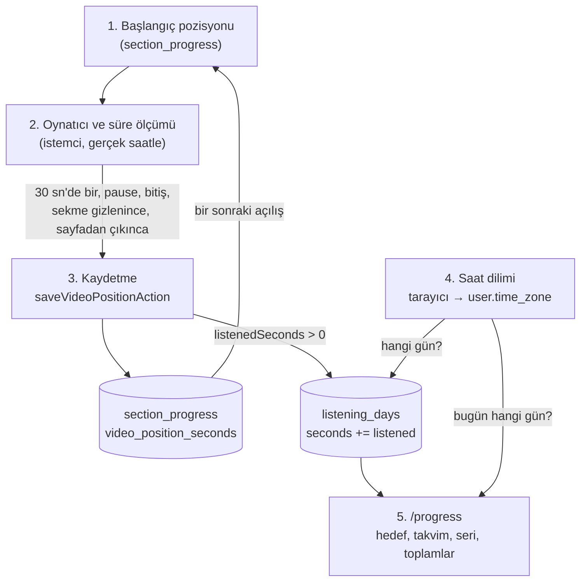
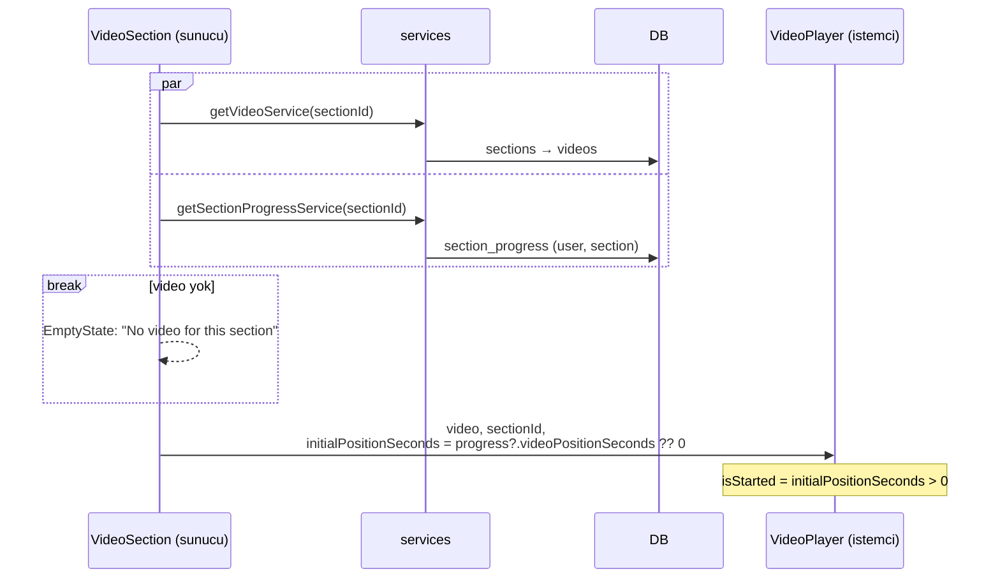
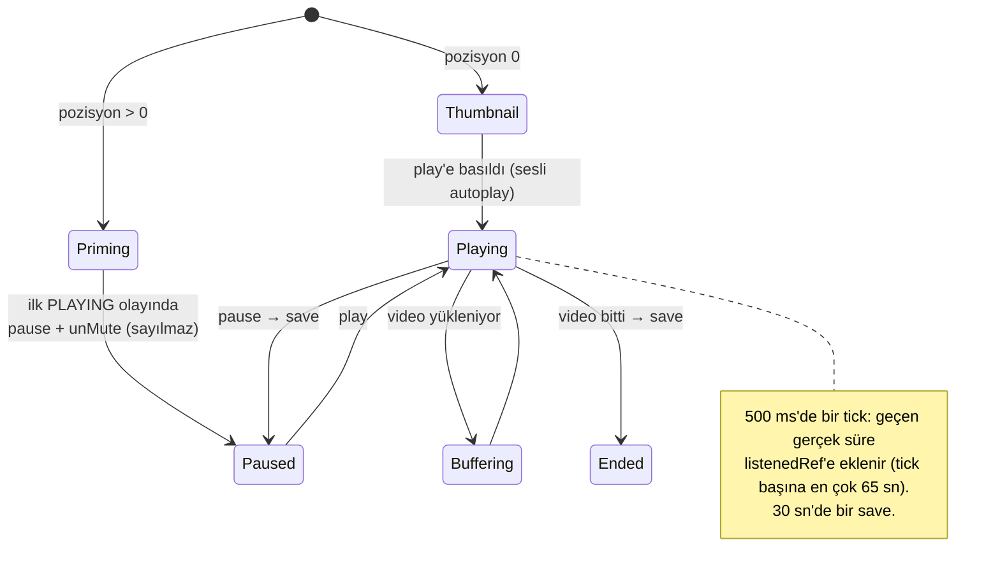
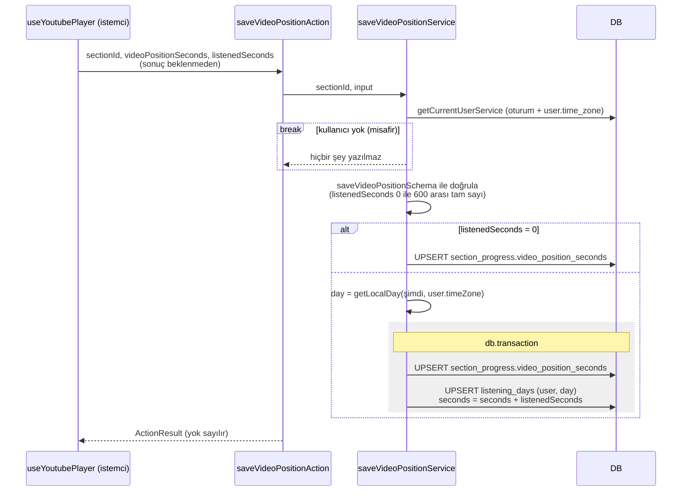
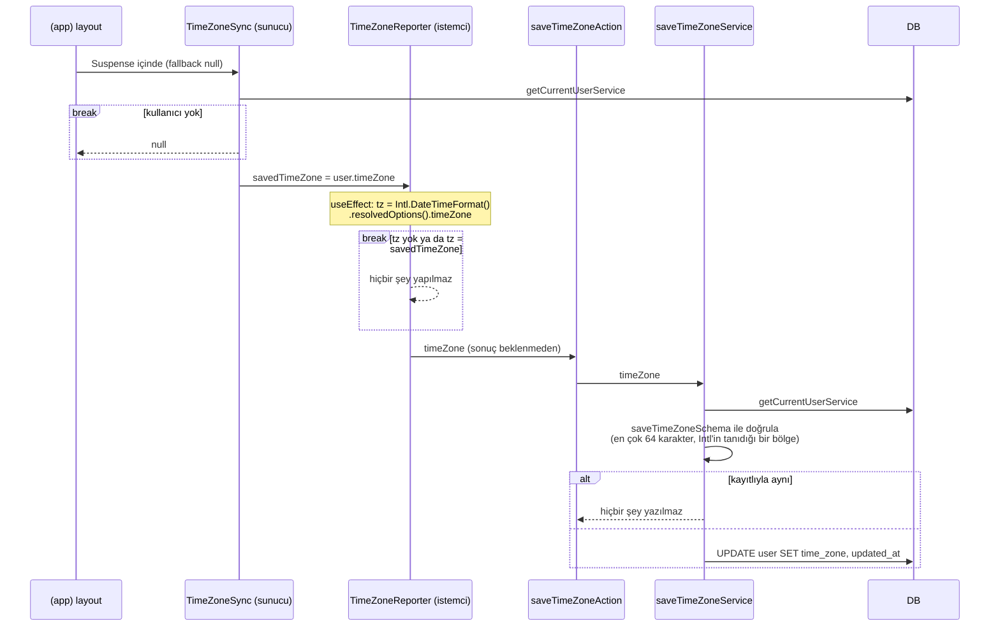
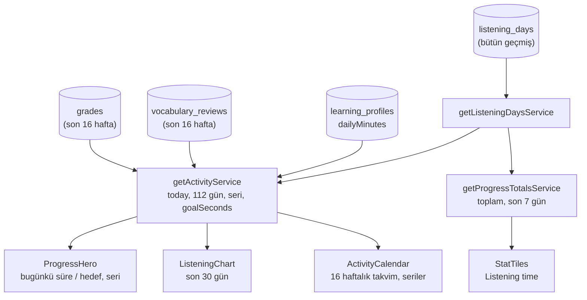

# Dinleme süresi akışı

Section sayfasındaki video oynatıcısının kaydettikleri. Oynatıcı iki şey gönderir: kullanıcının
videoda kaldığı saniye (pozisyon) ve son kayıttan beri gerçekten dinlediği süre. Pozisyon
`section_progress`'e yazılır ve video bir sonraki açılışta oradan devam eder. Süre, kullanıcının
**kendi takvimindeki** güne eklenir (`listening_days`). Günü belirleyen saat dilimini tarayıcı her
ziyarette bildirir. `/progress` bu günlerden günlük hedefi, aktivite takvimini, seriyi ve toplamları
hesaplar.

- **Giriş noktaları:**
  - Oynatıcı: `app/(app)/programs/[programSlug]/[sectionSlug]/_components/video-section/index.tsx`
  - Saat dilimi: `app/(app)/layout.tsx` (`TimeZoneSync`)
  - Okuma: `app/(app)/progress/page.tsx`
- **Okuduğu tablolar:** `section_progress`, `videos`, `user`, `learning_profiles`, `listening_days`
  (`/progress` ayrıca `grades` ve `vocabulary_reviews` okur)
- **Yazdığı tablolar:** `section_progress`, `listening_days`, `user` (`time_zone`)
- **AI görevleri:** yok

## Genel bakış

Akışın özü iki kural:

- **Süre, video pozisyonundan değil gerçek saatten ölçülür.** İleri sarmak süre eklemez, 2x hızda
  izlemek süreyi ikiye katlamaz, video yüklenirken beklenen süre sayılmaz.
- **Gün, kayıt anında ve kullanıcının saat dilimine göre belirlenir.** Saniyeler o güne eklenir ve
  satır bir daha taşınmaz. Saat dilimi henüz bilinmiyorsa gün UTC'ye göre hesaplanır.

## 1. Başlangıç pozisyonu

- **Nerede:** `video-section/index.tsx` → `getSectionProgressService` (`services/program.ts`) →
  `getSectionProgress` (`dal/program/queries.ts`). Pozisyon `video-player.tsx`'e verilir.
- **Okuduğu tablolar:** `sections`, `videos`, `section_progress`
- **Yazdığı tablolar:** yok
- **AI çağrısı:** yok
- **Dallanmalar:**
  - Section'ın videosu yoksa oynatıcı yerine bir `EmptyState` gösterilir.
  - Kullanıcı yoksa (misafir) `getSectionProgressService` `null` döner. Kullanıcının bu section
    için `section_progress` satırı yoksa da `null` döner. İki durumda da pozisyon 0'dır.
  - `VideoPlayer` pozisyon 0'dan büyükse oynatıcıyı **hemen** kurar, kullanıcı kaldığı kareyi
    görür. Pozisyon 0 ise yalnızca thumbnail ve play düğmesi görünür. YouTube iframe'i kullanıcı
    play'e basana kadar (ya da transcript'ten bir satıra tıklayana kadar) yüklenmez.

## 2. Oynatıcı ve dinleme süresinin ölçülmesi

Bütün ölçüm istemcide, `use-youtube-player.ts` hook'unda yapılır. Hook arayüz çizmez. Oynatıcıyı
kurar, kontrolleri (`togglePlay`, `play`, `seekTo`, `skip`) ve arayüzün göstereceği durumu
(`isReady`, `isPlaying`, `currentTime`, `duration`) döndürür.

- **Nerede:** `video-section/use-youtube-player.ts`, `video-player.tsx` içinden çağrılır.
- **Okuduğu / yazdığı tablolar:** yok. Kayıt 3. bölümde.
- **API yükleme:** `loadYoutubeApi` YouTube'un IFrame API script'ini sayfaya **bir kez** ekler.
  Aynı anda istek gelirse hepsi modül seviyesindeki aynı promise'i bekler. YouTube kendisine
  verilen elementi silip yerine `<iframe>` koyduğu için ona React'in yönettiği bir node değil, elle
  oluşturulmuş boş bir `div` verilir.
- **Priming:** kayıtlı pozisyon varsa YouTube, oynatılmadan önce o kareyi değil videonun kapağını
  gösterir. Bu yüzden oynatıcı o saniyeden sessiz olarak otomatik başlatılır ve ilk `PLAYING`
  olayında hemen durdurulup sesi açılır. Bu sırada `isPlaying` hiç `true` olmadığı için bu kısa
  oynatma süreye sayılmaz.
- **Süre ölçümü (`listenedRef`):**
  - Yalnızca `isPlaying` `true` iken çalışır. Buffering de "oynamıyor" sayılır.
  - 500 ms'de bir `countListened` çalışır ve bir önceki tick'ten beri geçen **gerçek süreyi**
    (`Date.now()` farkı) sayaca ekler. Aynı tick'te pozisyon da okunur (`positionRef`,
    `currentTime`).
  - Oynatma durunca effect'in cleanup'ı `countListened`'ı bir kez daha çağırır, son tick'ten
    beri geçen parça da eklenir.
  - İki tick arasında en fazla **65 sn** sayılır (`MAX_TICK_GAP_MS`). Arka plandaki sekmede
    tarayıcı zamanlayıcıları dakikada bire kadar yavaşlatır. Video çalmaya devam ettiği için bu
    süre sayılmalıdır. Uykuya geçip saatler sonra açılan bir laptopun o saatleri ise sayılmamalıdır.
- **Kaydın tetiklendiği anlar:**
  - oynarken 30 sn'de bir (`SAVE_INTERVAL_MS`)
  - `PAUSED` ya da `ENDED` olayında
  - sekme gizlenince (`visibilitychange` → `hidden`: sekme değişimi, küçültme, mobilde uygulamayı
    arka plana alma)
  - sayfadan çıkınca (unmount)
  - Seek kayıt **tetiklemez**. Yeni pozisyon bir sonraki tetikleyicide gider.
- **`save(seconds)`:**
  1. Pozisyon tam saniyeye yuvarlanır.
  2. Gönderilecek süre `listenedRef`'in tam saniye kısmıdır, en çok 600 (`MAX_LISTENED_SECONDS`).
  3. Pozisyon son gönderilenle aynıysa ve süre 0 ise istek atılmaz.
  4. Gönderilen saniyeler sayaçtan düşülür. Küsurat ve 600'ü aşan kısım sayaçta kalır, bir
     sonraki kayda eklenir.
  5. `saveVideoPositionAction` çağrılır, sonucu **beklenmez**, hata yutulur. Kayıt hatası oynatmayı
     bozmamalıdır.
- **Neden ref:** `positionRef` ve `listenedRef` state olsaydı her 500 ms'de bileşen yeniden render
  olur, kaydetme effect'leri yeniden kurulurdu. Ekranda görünen saniye ayrıca `currentTime`
  state'inde tutulur.

---

**Notlar**

- 600 sınırı bir güvenlik önlemi değildir. Sunucu tek kayıtta 600'den fazlasını reddettiği için
  istemci de aynı sınırı uygular, böylece gerçekten ölçülmüş süre reddedilip kaybolmaz. Normalde 30
  sn'de bir kayıt yapıldığı için bu sınıra yaklaşılmaz.
- Pause anında önce `onStateChange` içindeki `save` çalışır, effect'in cleanup'ı (son
  `countListened`) ise bir sonraki render'dan sonra. Son tick ile pause arasındaki 500 ms'den kısa
  parça o kayda girmez, sayaçta kalıp sonrakine gider. Kaybolmaz.
- Unmount'ta cleanup'lar tanım sırasıyla çalışır: önce oynatıcı yok edilir, sonra oynuyorsa son
  parça sayaca eklenir, en son kaydedilir. `save` oynatıcıyı değil `positionRef`'i okuduğu için
  oynatıcının yok edilmiş olması sorun değildir.

## 3. Kaydetme

- **Nerede:** `saveVideoPositionAction` (`actions/program.ts`) → `saveVideoPositionService`
  (`services/program.ts`) → `upsertSectionProgress`, `upsertListeningDay`
  (`dal/program/mutations.ts`). Gün `getLocalDay` (`lib/time-zone.ts`) ile hesaplanır.
- **Okuduğu tablolar:** `user` (oturum ve `time_zone`)
- **Yazdığı tablolar:** `section_progress`, `listening_days`
- **AI çağrısı:** yok
- **Dallanmalar:**
  - Kullanıcı yoksa servis hiçbir şey yapmadan döner, hata da vermez. Misafir de video izleyebilir,
    ama pozisyonu ve süresi saklanmaz. Kullanıcı kontrolü doğrulamadan önce yapıldığı için
    misafirin geçersiz girdisi de sessizce yok sayılır.
  - Girdi şemaya uymazsa (örneğin `listenedSeconds` 600'den büyükse) hata fırlatılır ve **hiçbir
    şey** yazılmaz, pozisyon da.
  - `listenedSeconds` 0 ise yalnızca pozisyon yazılır, transaction açılmaz. Durdurulmuş videoda
    seek yapıp sekmeyi değiştirmek bu duruma örnektir.
  - Süre varsa iki yazma **tek transaction**'da yapılır: ya ikisi birden yazılır ya hiçbiri.
- **`upsertSectionProgress`:** `(user_id, section_id)` için satır yoksa ekler, varsa yalnızca
  verilen alanı (`video_position_seconds`) günceller. Yani bir section'ın `section_progress` satırı
  quiz bitince değil, videonun ilk kaydında oluşur. `quiz_completed_at`'e dokunulmaz.
- **`upsertListeningDay`:** `(user_id, day)` için satır yoksa `seconds = listenedSeconds` ile
  ekler. Varsa üzerine **yazmaz, ekler**: `seconds = seconds + listenedSeconds`. Ekleme SQL içinde
  yapıldığı için aynı anda gelen iki kayıt birbirinin saniyelerini ezmez. Tabloda
  `(user_id, day)` tekilliği vardır: kullanıcı başına günde bir satır, bir yıllık geçmiş bile
  küçük kalır.
- **Gün (`getLocalDay`):** isteğin sunucuya ulaştığı an, kullanıcının saat dilimine göre
  `"YYYY-MM-DD"` biçimine çevrilir (`en-CA` yerel ayarı bu biçimi verir). `user.timeZone` `null`
  ise UTC kullanılır. `day` sütunu `date` tipindedir, Drizzle onu string olarak döndürür.

## 4. Saat diliminin bildirilmesi

Bir saniyenin hangi güne ait olduğunu yalnızca tarayıcı bilir. Sunucu kullanıcının nerede
olduğunu bilmez, bu yüzden tarayıcı kendi saat dilimini her ziyarette bildirir.

- **Nerede:** `app/(app)/layout.tsx` → `_components/time-zone-sync/index.tsx` (`TimeZoneSync`) →
  `time-zone-reporter.tsx` (`TimeZoneReporter`) → `saveTimeZoneAction` (`actions/user.ts`) →
  `saveTimeZoneService` (`services/user.ts`) → `updateUser` (`dal/user/mutations.ts`)
- **Okuduğu tablolar:** `user`
- **Yazdığı tablolar:** `user` (`time_zone`)
- **AI çağrısı:** yok
- **Dallanmalar:**
  - Misafir için `TimeZoneSync` `null` döner, istemciye hiçbir şey gitmez. Misafirin saat dilimini
    saklayacak bir yer yoktur.
  - Tarayıcı bir saat dilimi döndürmezse ya da dönen değer kayıtlıyla aynıysa istek atılmaz.
    Normalde yalnızca ilk ziyarette ve kullanıcı saat dilimi değiştirdiğinde istek gider.
  - Sunucu iki kontrolü yeniden yapar: değerin gerçek bir IANA bölgesi olup olmadığını
    (`isTimeZone`: `Intl.DateTimeFormat` geçersiz bölgede hata fırlatır) ve kayıtlıyla aynı olup
    olmadığını. İstemciye güvenilmez.
  - İstek başarısız olursa hata yutulur. Günler bir sonraki ziyarete kadar eski saat dilimine (ya
    da UTC'ye) göre sayılır.
- **Değer nereden geliyor:** `Intl.DateTimeFormat().resolvedOptions().timeZone` tarayıcının saat
  dilimidir. Tarayıcı bunu işletim sisteminin ayarından alır, yani pratikte cihazın saat dilimidir
  (`"Europe/Istanbul"` gibi).
- **Kim yazabilir:** `timeZone` better-auth'ta ek alan olarak tanımlıdır (`lib/auth.ts`) ve
  `input: false`'tur. İstemci onu `authClient.updateUser()` ile değiştiremez. Tek yazan bu
  servistir. `updateUser`, better-auth'un `user` tablosunda `$onUpdate` olmadığı için
  `updated_at`'i elle günceller.

---

**Notlar**

- Layout'lar sayfalar arası geçişte yeniden render edilmediği için `TimeZoneReporter` pratikte her
  tam sayfa yüklemesinde bir kez çalışır. Effect `savedTimeZone`'a bağlıdır. Bir `router.refresh`
  layout'u yeniden render ederse effect tekrar çalışır, ama değer artık kayıtlıyla aynı olduğu için
  istek atmaz.
- Kayıttan sonra sayfa yenilenmez (`revalidate` yok). O an ekranda olan sayfa eski saat dilimiyle
  hesaplanmış kalır, yeni değer bir sonraki istekte kullanılır.

## 5. `/progress`'te okunması

`listening_days`'in tek okuyucusu `/progress` sayfasıdır. Sayfanın dinleme süresi kullanan
bölümleri iki servisten beslenir, ikisi de React `cache` ile sarılıdır: aynı istekte kaç bileşen
çağırırsa çağırsın bir kez hesaplanır.

### `getListeningDays`

- **Nerede:** `getListeningDaysService` (`services/program.ts`) → `getListeningDays`
  (`dal/program/queries.ts`)
- Kullanıcının **bütün** günlerini eskiden yeniye döndürür, yalnızca `day` ve `seconds`. Pencere
  yoktur. Günde bir satır olduğu için tüm geçmiş küçük kalır.
- Misafire boş liste döner.

### `getActivityService`

- **Nerede:** `services/progress.ts`
- **Okuduğu servisler** (`Promise.all` ile paralel):
  - `getListeningDaysService`: bütün dinleme günleri
  - `getGradesService`: son 16 haftanın (`PROGRESS_WINDOW_DAYS` = 112 gün) cevapları
  - `getVocabularyReviewsService`: son 16 haftanın kelime tekrarları
  - `getLearningProfileService`: günlük hedef için profil
- **Hesap:**
  1. `today` = şu an, kullanıcının saat dilimine göre (`getLocalDay`).
  2. Her gün için bir kayıt (`ActivityDay`: `listeningSeconds`, `answers`, `reviews`) toplanır.
     Dinleme günleri **zaten yerel gündür**, olduğu gibi eklenir. Cevap ve tekrarların ise
     zaman damgası (`createdAt`) vardır, okuma anında kullanıcının **şimdiki** saat dilimiyle güne
     çevrilir.
  3. Bu üçünden biri sıfırdan büyük olan gün **aktif** sayılır.
  4. `days`: bugünle biten, eskiden yeniye 112 günlük dizi. Kaydı olmayan gün sıfırlarla doldurulur.
  5. Seriler (`getStreaks`):
     - **Güncel seri:** bugün aktifse bugünden, değilse dünden başlayıp geriye doğru aktif günler
       sayılır. Yani bugün henüz bir şey yapılmadıysa seri bozulmaz, bir gün tamamen boş geçince
       bozulur.
     - **En uzun seri:** bütün aktif günler sıralanır, art arda gelen en uzun dizi bulunur.
  6. `goalSeconds` = `dailyMinutes × 60`. Profil yoksa `null`.
- **Döndürdüğü:** `Activity` (`today`, `days`, `currentStreak`, `longestStreak`, `goalSeconds`).
  Kullanıcı yoksa `null`.

### `getProgressTotalsService`

- Dinleme için iki sayı hesaplar (diğer toplamlar bu akışın dışında):
  - `listeningSeconds`: bütün günlerin toplamı
  - `listeningSecondsThisWeek`: `day >= today - 6` olan günlerin toplamı. Takvim haftası değil,
    bugün dahil **son 7 gün**. Günler `"YYYY-MM-DD"` biçiminde olduğu için string karşılaştırması
    tarih sırasıyla aynıdır.

### Bileşenler

- **`ProgressHero`** (`progress-hero/index.tsx`): bugünkü süre `activity.days`'in son elemanıdır.
  Hedef varsa `GoalRing` bugünkü dakikayı hedefe oranlayarak çizer, hedefe ulaşılınca yeşil tik
  gösterir (`"12 / 15 min"`). Karşılama cümlesi önce hedefe, sonra seriye bakar: hedef tamamsa
  "Today's listening goal is done", seri varsa "Keep your streak going", yoksa "A few minutes today
  starts a new streak". Kullanıcı yoksa tüm sayfa için giriş çağrısı yapan `EmptyState` buradadır.
  Aynı kartta **Continue watching** son güncellenen `section_progress` satırını (`updatedAt`)
  pozisyonuyla birlikte gösterir.
- **`ListeningChart`** (`listening-chart.tsx`): son 30 günün dakikaları çubuk grafik olarak çizilir.
  Hedef varsa kesikli bir hedef çizgisi çıkar, hedefe ulaşılan çubuklar koyu renktedir. Başlıkta
  30 günün toplamı ve hedefin kaç gün tutturulduğu yazar.
- **`ActivityCalendar`** (`activity-calendar/`): 16 haftalık takvim, güncel ve en uzun seri. Bir
  günün rengi bir puana göre seçilir: `dinlenen tam dakika + cevap sayısı + tekrar sayısı`. Eşikler
  1, 10, 25 ve 50'dir. 1 dakikadan az dinlenen gün puanı 0 olsa da en açık aktif renkle gösterilir.
- **`StatTiles`** (`stat-tiles.tsx`): **Listening time** kutusu toplam süreyi ve "this week" olarak
  son 7 günü gösterir.

## Kenar durumlar

- **Misafir:** oynatıcı çalışır ve istemci yine kayıt isteği atar, ama sunucu sessizce yok sayar.
  Misafirken dinlenen süre kayıt olunca hesaba geçmez. Saat dilimi de bildirilmez.
- **Gece yarısı:** gün, isteğin sunucuya ulaştığı ana göre belirlenir. 00:00:20'de gelen bir kayıt
  önceki günün son ~30 saniyesini (arka plan sekmesinde ~65 saniyeye kadar) da taşır ve hepsi yeni
  güne yazılır.
- **Saat dilimi henüz bilinmiyorsa:** ilk ziyaretteki saat dilimi bildirimi ulaşmadan yapılan
  kayıtlar UTC gününe yazılır ve orada kalır.
- **Saat dilimi değişirse (seyahat):** eski `listening_days` satırları yazıldıkları günde kalır,
  yeniden hesaplanmaz. Cevap ve tekrarların günü ise okuma anında yeni saat dilimiyle hesaplanır.
  Aynı aktivite takviminde iki kaynak farklı saat dilimleriyle sayılmış olabilir, bir cevap
  dinlemeyle aynı gün yapılmış olsa bile komşu güne düşebilir.
- **Uyku / kapalı kapak:** oynatma durmadan laptop uykuya geçerse uyanınca en çok 65 saniye
  eklenir.
- **Sekme kapanınca ya da sayfa yenilenince:** son kayıt isteği gönderilir, ama sayfa kapanmadan
  tamamlanacağının garantisi yoktur (`sendBeacon` / `keepalive` kullanılmıyor). Son ~30 saniye
  kaybolabilir.

## Notlar

- **Kayıp süre:** gönderilen saniyeler istek atılmadan önce sayaçtan düşülür. İstek başarısız
  olursa (ağ hatası, oturumun düşmesi) o saniyeler geri eklenmez ve kaybolur.
- **İstemciye güveniyor:** süre tamamen istemcide ölçülür. Sunucu yalnızca tek kaydın 0 ile 600
  arasında olduğunu kontrol eder. İstek sayısına, son kayıttan beri geçen süreye ya da günlük
  toplama bakılmaz. Action'ı doğrudan çağıran biri bir günü istediği kadar dinlenmiş gösterebilir.
  Etkisi yalnızca kullanıcının kendi istatistikleridir (hedef, takvim, seri, toplamlar).
- **Dinleme ve cevap pencereleri farklı:** dinleme günleri bütün geçmişten okunur, cevap ve
  tekrarlar son 16 haftadan. En uzun seri bu karışık küme üzerinden hesaplanır. 16 haftadan eski
  bir seri yalnızca dinleme günlerinden oluşuyorsa tam sayılır, cevap ya da tekrarla aktif olan
  günler ise o dönemde görünmez. Eski seriler olduğundan kısa çıkabilir.
- **"Bugün" iki farklı tanım:** `/progress` günü `user.timeZone` ile sayar. Practice'in günlük seti
  hâlâ 20 saatlik pencere kullanır (bkz. [practice.md](./practice.md)). İki sayfanın "bugün"ü
  birbirini tutmayabilir.
- `section_progress.updated_at` her pozisyon kaydında değişir. "Continue watching" en son kaydedilen
  section'ı bu sütuna göre bulur.
