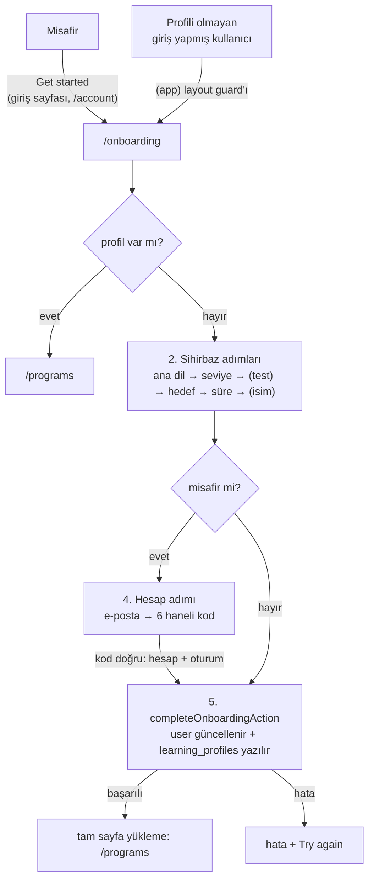
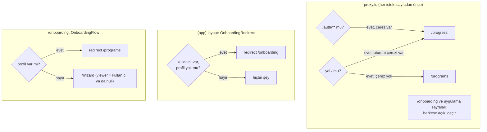
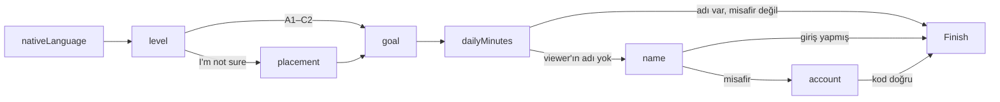
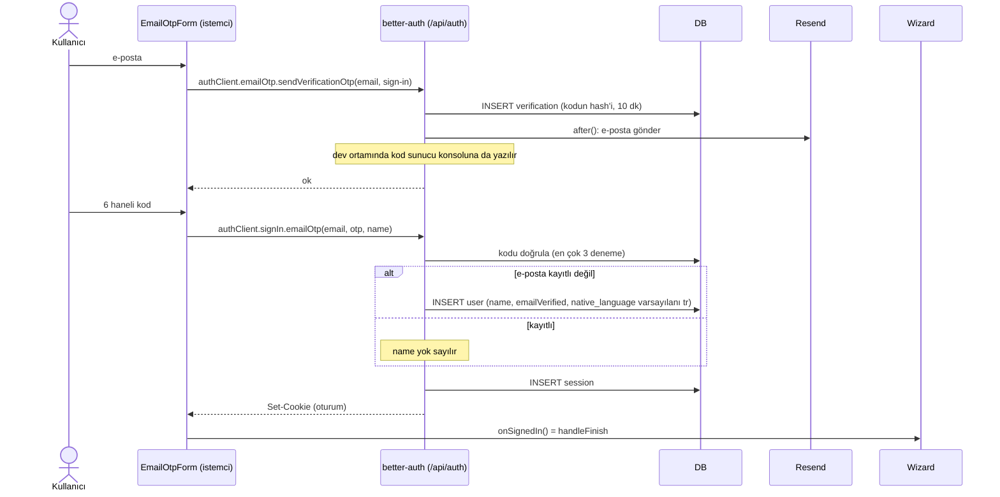
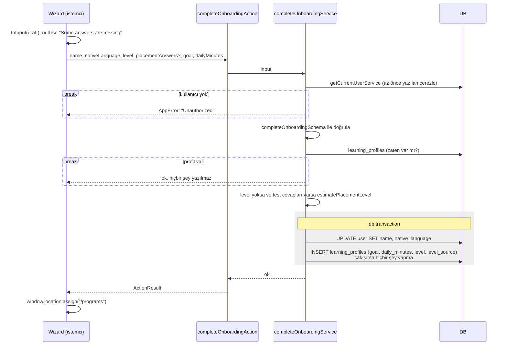

# Onboarding akışı

Onboarding aynı zamanda kayıttır. Misafir önce sorulara cevap verir (ana dil, seviye, gerekirse
seviye testi, hedef, günlük süre, isim), en sonda e-postasını yazar ve gelen kodu girer. Kod
doğrulanınca hesap açılır ve cevaplar `learning_profiles`'a yazılır. Şifre yoktur. Profili olmayan
giriş yapmış kullanıcılar da buraya yönlendirilir: profilin olması "onboarding'i bitirmiş" olmak
demektir, ayrı bir bayrak yoktur.

- **Giriş noktaları:**
  - Sihirbaz: `app/onboarding/page.tsx`
  - Yönlendirmeler: `proxy.ts`, `app/(app)/_components/onboarding-redirect.tsx`
  - Giriş sayfası (yalnızca kod ile giriş): `app/auth/login/page.tsx`
- **Okuduğu tablolar:** `user`, `session`, `learning_profiles` (kod doğrulamada `verification`)
- **Yazdığı tablolar:** `user` (`name`, `native_language`; yeni hesapta satırın kendisi),
  `session`, `verification`, `learning_profiles`
- **AI görevleri:** yok

## Genel bakış

Akışın özü iki kural:

- **Profil = onboarding bitti.** `learning_profiles` satırı olan kullanıcı onboarded sayılır.
  Profili olmayan kullanıcı uygulamanın sayfalarından `/onboarding`'e geri gönderilir, profili
  olan da `/onboarding`'den `/programs`'a.
- **Önce hesap, sonra profil.** Misafirde kullanıcı satırı better-auth tarafından kod doğrulanınca
  oluşturulur, profil ancak ondan sonra yazılır. İkisi ayrı isteklerdir. Arada bir hata olursa
  kullanıcı hesabı olan ama profili olmayan biri olarak kalır ve bir sonraki ziyarette sihirbaza
  geri döner.

## 1. Yönlendirmeler

Kimin nereye gideceğine üç yer karar verir.

- **Nerede:** `proxy.ts`, `app/(app)/layout.tsx` → `_components/onboarding-redirect.tsx`,
  `app/onboarding/_components/onboarding-flow/index.tsx`
- **Okuduğu tablolar:** `user`, `session` (oturum), `learning_profiles`
- **Yazdığı tablolar:** yok
- **`proxy.ts`:**
  - `/` için yalnızca oturum **çerezinin varlığına** bakar, oturumu doğrulamaz. Çerez varsa
    `/progress`'e, yoksa `/programs`'a yönlendirir. Süresi dolmuş bir çerez de `/progress`'e
    gönderir, o sayfa misafire giriş çağrısı gösterir.
  - `/auth/**` yalnızca misafirlere açıktır. Çerezi olan `/progress`'e gönderilir.
  - `/onboarding` ve uygulama sayfaları (`/progress`, `/programs`, `/practice`, `/account`,
    `/vocabulary`) herkese açıktır. Diğer bütün yollar yalnızca admin içindir, diğerlerine 404
    gösterilir.
- **Layout guard'ı (`OnboardingRedirect`):** `(app)` layout'unda kendi `Suspense` sınırında render
  edilir. Böylece layout senkron kalır ve sayfa paralel olarak akmaya başlar. Kullanıcı varsa ve
  profili yoksa `/onboarding`'e yönlendirir. Misafir hiçbir zaman yönlendirilmez. `/onboarding`
  `(app)` grubunun dışında olduğu için guard orada çalışmaz, döngü oluşmaz.
- **Sihirbazın kendi kontrolü (`OnboardingFlow`):** profili olan kullanıcı `/programs`'a
  yönlendirilir. Yoksa `Wizard`'a `viewer` verilir: giriş yapmış kullanıcının adı ve ana dili, ya da
  misafir için `null`.

---

**Notlar**

- Guard yalnızca sayfa yönlendirmesidir. Profil gerektiren servisler profili kendileri kontrol eder
  (örneğin `getQuizService` profil yoksa `null` döner, bkz. [quiz-answer.md](./quiz-answer.md)).
- Yeni hesabın saat dilimi de bu layout'ta bildirilir (`TimeZoneSync`). `/onboarding` layout'un
  dışında olduğu için bildirim, onboarding bitip `/programs` açılınca yapılır (bkz.
  [listening-days.md](./listening-days.md#4-saat-diliminin-bildirilmesi)).

## 2. Sihirbaz adımları

Bütün cevaplar istemcide, `Wizard`'ın `draft` state'inde tutulur. Son adıma kadar sunucuya hiçbir
şey gitmez.

- **Nerede:** `onboarding-flow/wizard.tsx`, `steps.ts` (adımlar, metinler, `toInput`),
  `step-field.tsx` (her adımın alanı), `options.ts` (seçenekler), `choice-list.tsx`
- **Okuduğu / yazdığı tablolar:** yok
- **Adımların belirlenmesi (`buildSteps`):** her render'da `viewer` ve `draft`'tan yeniden hesaplanır.
  - `nativeLanguage` ve `level` her zaman vardır.
  - `placement` yalnızca seviye "I'm not sure" (`UNSURE_LEVEL`) seçildiyse eklenir.
  - `goal` ve `dailyMinutes` her zaman vardır.
  - `name`, `viewer`'ın adı yoksa eklenir: misafirde ve adı boş olan hesapta.
  - `account` yalnızca misafirde eklenir.
- **`draft`'ın başlangıcı:** `nativeLanguage` ve `name` `viewer`'dan gelir (misafirde boş). Diğer
  alanlar boştur.
- **İlerleme (`canContinue`):** her adımda o adımın cevabı olmadan **Continue** açılmaz. İsim
  kırpıldıktan sonra boş olmamalıdır. Seviye testinde bütün sorular cevaplanmış (ya da "I don't
  know" denmiş) olmalıdır. `account` adımında düğme yoktur, ilerleme kod formuyla olur.
- **Geri:** ok düğmesi bir önceki adıma döner, cevaplar kaybolmaz. Seviye "I'm not sure"dan başka
  bir seviyeye değiştirilirse `placement` adımı listeden çıkar, test cevapları `draft`'ta kalır ama
  gönderilmez.
- **Son adım:** misafirde `account`, giriş yapmış kullanıcıda `name` ya da `dailyMinutes`. Giriş
  yapmış kullanıcıda son adımın düğmesi **Finish** olur ve `handleFinish`'i çağırır.
- **`toInput`:** `draft`'ı action girdisine çevirir. Eksik bir alan varsa `null` döner ve "Some
  answers are missing" hatası gösterilir. Seviye "I'm not sure" ise `level: null` ve test cevapları
  (`{ questionId, optionIndex }` listesi) gider, değilse seviye gider ve test cevapları gitmez.

## 3. Seviye testi

Yalnızca kullanıcı seviyesini bilmediğini söylerse gösterilir. 15 çoktan seçmeli soru, A1'den
C1'e her seviyeden 3 tane (`constants/placement.ts`). C2 test edilmez: kısa bir test C1'i C2'den
ayıramaz.

- **Nerede:** `onboarding-flow/placement-test.tsx`
- **İstemcide:** sorular tek tek gösterilir. Bir seçenek seçilince cevap kaydedilir ve sonraki
  soruya geçilir. "I don't know" `null` olarak kaydedilir. **Previous question** ile geri
  dönülebilir. Bileşen yeniden açılırsa ilk cevaplanmamış sorudan başlar. Her soru için
  `ChoiceList` `key` ile yeniden oluşturulur, böylece önceki sorunun seçimi yeni soruda seçili
  görünmez.
- **Puanlama sunucuda** yapılır (5. bölüm). Cevap anahtarı istemciye de gider. Bu bilinçli bir
  tercih: test kayıttan önce çalışıyor ve sonucu yalnızca kullanıcının kendi başlangıç seviyesini
  belirliyor, korunacak bir şey yok.
- Test cevapları **saklanmaz**, yalnızca sonuçtaki seviye saklanır.

## 4. Hesap adımı (e-posta → kod)

Yalnızca misafirde. Giriş sayfası da aynı formu (`EmailOtpForm`) kullanır.

- **Nerede:** `components/shared/email-otp-form.tsx` → `authClient` (`lib/auth-client.ts`) →
  better-auth `emailOTP` eklentisi (`lib/auth.ts`). Doğrulama şemaları `schemas/auth.ts`.
- **Okuduğu tablolar:** `user`, `verification`
- **Yazdığı tablolar:** `verification`, `user` (yeni hesapta), `session`
- **AI çağrısı:** yok. E-posta Resend ile gider.
- **Neden server action değil:** çağrılar `authClient` üzerinden better-auth'un `/api/auth`
  uçlarına gider, böylece better-auth'un rate limit'leri uygulanır. Bu yüzden e-posta ve kod
  şemaları yalnızca istemcide doğrulanır, sunucudaki doğrulamayı better-auth yapar.
- **Ayarlar (`lib/auth.ts`):** 6 haneli kod, 10 dakika geçerli, veritabanında hash'lenmiş olarak
  tutulur (`storeOTP: "hashed"`). E-posta `after()` ile yanıt gittikten sonra gönderilir. Gönderim
  hatası yalnızca loglanır. Oturumlar 30 gün geçerlidir ve kullanıldıkça günde bir uzar: her girişin
  bir e-posta kutusu ziyaretine mal olduğu için oturumlar uzun tutulur.
- **Dallanmalar:**
  - Kod gönderilemezse ya da kod yanlışsa better-auth'un hata mesajı formda gösterilir. Aynı kod
    için 3 yanlış denemeden sonra kod geçersiz olur ve yeni kod istenmelidir.
  - **Change email** ilk forma döner, **Resend code** aynı adrese yeni kod ister.
  - E-posta kayıtlı değilse better-auth kullanıcıyı oluşturur: sihirbazdaki isim, doğrulanmış
    e-posta, ek alanların varsayılanları (`native_language = tr`, `plan = free`, `role = user`,
    `time_zone = null`). Kayıtlıysa isim yok sayılır ve var olan hesapla giriş yapılır.
  - İki durumda da oturum çerezi yanıtla birlikte yazılır ve `handleFinish` çağrılır.
- **Ek alanlar istemciden yazılamaz:** `nativeLanguage`, `plan`, `role` ve `timeZone` better-auth'ta
  `input: false`'tur. Kayıt isteğine eklense bile yok sayılır. Ana dil, kayıttan sonra
  `completeOnboardingService` tarafından yazılır.

## 5. Profilin yazılması

- **Nerede:** `wizard.tsx` (`handleFinish`) → `completeOnboardingAction`
  (`actions/learning-profile.ts`) → `completeOnboardingService` (`services/learning-profile.ts`) →
  `updateUser` (`dal/user/mutations.ts`), `createLearningProfile`
  (`dal/learning-profile/mutations.ts`)
- **Okuduğu tablolar:** `user` (oturum), `learning_profiles`
- **Yazdığı tablolar:** `user` (`name`, `native_language`), `learning_profiles` (tek transaction)
- **AI çağrısı:** yok
- **Doğrulama (`completeOnboardingSchema`):** isim kırpılmış, 1–60 karakter. Ana dil desteklenen
  dillerden biri. Seviye bir CEFR seviyesi ya da `null`. Hedef `work`, `travel`, `exam` ya da `fun`.
  Günlük süre 5, 10, 15, 20 ya da 30. Test cevapları en çok 50 tane, soru id'si en çok 40 karakter,
  seçenek 0–9 ya da `null`.
- **Seviye ve kaynağı (`level`, `level_source`):**
  - Kullanıcı seviyesini seçtiyse o seviye yazılır, kaynak `self` olur. Test cevapları gelse bile
    kullanılmaz: kullanıcının kendi beyanı kazanır.
  - Seviye yoksa ve test cevapları varsa seviye testten hesaplanır, kaynak `placement` olur.
  - İkisi de yoksa seviye ve kaynak `null` olur. Arayüz bu durumu hiç üretmez (bkz. Notlar).
- **Test puanlaması (`estimatePlacementLevel`):** seviyeler A1'den C1'e sırayla gezilir. Bir
  seviyenin 3 sorusundan en az 2'si (`PLACEMENT_PASS_RATIO` = 2/3) doğruysa tahmin o seviyeye
  çıkar, değilse durulur. Yani bir seviye, altındaki bütün seviyeler de geçildiyse kazanılır.
  Cevaplanmamış ve "I don't know" yanlış sayılır. A1 tabandır: A1 bile geçilmese sonuç A1'dir.
  En yüksek sonuç C1'dir.
- **Dallanmalar:**
  - Oturum yoksa `Unauthorized` döner. Misafirde bu, kod doğrulandıktan sonra çerezin istekle
    gitmemesi demektir. Normalde olmaz.
  - Girdi şemaya uymazsa Zod'un ilk hata mesajı döner.
  - Kullanıcının zaten profili varsa servis **hata vermeden** döner ve hiçbir şey yazmaz. Sayfa
    yine `/programs`'a gider.
  - Başarılıysa sayfa `window.location.assign("/programs")` ile **tamamen** yeniden yüklenir.
    Böylece sunucu yeni oturumu ve profili baştan okur, istemcideki önbellek kullanılmaz.
  - Hata olursa `Wizard` hatayı gösterir. `account` adımında ayrıca **Try again** düğmesi çıkar:
    kullanıcı giriş yapmış ama profil yazılamamıştır, yalnızca profil kısmı yeniden denenir.
- **Neden transaction:** isim, ana dil ve profil birlikte yazılmalıdır. Profil yazılamazsa ana
  dil de değişmez, kullanıcı yarım bir durumda kalmaz.

## Kenar durumlar

- **Kayıtlı e-postayla onboarding:** misafir sihirbazı bitirip zaten hesabı olan bir e-posta
  yazarsa kod doğrulanınca o hesapla giriş yapılır. Hesabın profili varsa yeni cevaplar sessizce
  atılır ve kullanıcı `/programs`'a gider. Profili yoksa cevaplar yazılır, isim ve ana dil de
  güncellenir.
- **Giriş sayfasından yeni e-posta:** `/auth/login` de kayıtlı olmayan e-postaya hesap açar (isim
  boş, ana dil `tr`). Giriş sonrası açılan uygulama sayfasında layout guard'ı kullanıcıyı
  `/onboarding`'e gönderir. Sihirbaz `account` adımı olmadan ve isim adımıyla açılır.
- **Kod doğrulandı ama profil yazılamadı:** kullanıcı artık giriş yapmıştır. **Try again** yalnızca
  profili yeniden dener. Sayfa yenilenirse `draft` kaybolur ve sihirbaz giriş yapmış kullanıcı
  için (`account` adımı olmadan) baştan başlar. Uygulamanın başka bir sayfasına gidilirse guard
  yine `/onboarding`'e gönderir.
- **Onboarded kullanıcı `/onboarding`'i açarsa:** `/programs`'a yönlendirilir.
- **Giriş yapmış kullanıcı `/auth/login`'i açarsa:** proxy `/progress`'e gönderir. Profili yoksa
  oradan da `/onboarding`'e gider.

## Notlar

- **`level_source`:** kullanıcının seçtiği seviye `self`, testten gelen seviye `placement` olarak
  kaydedilir. `/progress`'teki seviye tahmini bu bilgiyi gösterir ("The level you picked at
  sign-up" ya da "Set by your placement test"). Tahmin profildeki seviyenin altına inmez, profil
  de hiçbir zaman değiştirilmez.
- **`level = null` durumu:** şema yorumu `null`'ı "seviye testi bekliyor" olarak tanımlıyor, ama
  arayüz bu durumu üretmiyor: "I'm not sure" seçen kullanıcı testi bitirmeden ilerleyemiyor ve test
  her zaman en az A1 veriyor. `null` yalnızca action doğrudan, seviyesiz ve test cevapsız
  çağrılırsa oluşur. Testi sonradan yapmanın da bir yolu yok.
- **Eşzamanlı iki istek:** iki istek "profil var mı?" kontrolünü aynı anda geçerse ikisi de
  `user`'ı günceller, ama `learning_profiles`'taki `user_id` tekilliği ve `onConflictDoNothing`
  sayesinde yalnızca bir profil yazılır. Arayüzde `isFinishing` çift tıklamayı engeller.
- **Bitişten sonraki sayfa:** onboarding ve giriş varsayılan olarak `/programs`'a gider (ilk video
  seçilsin diye). Giriş yapmış kullanıcının ana sayfası (`/`) ise `/progress`'tir.
- **Rate limit:** better-auth'un rate limit'i (OTP uçları için 60 saniyede 3 istek) varsayılan
  olarak yalnızca production'da açıktır ve bellekte tutulur (`secondaryStorage` tanımlı değil).
  Birden fazla sunucu örneğinde (serverless) her örneğin kendi sayacı olur.
