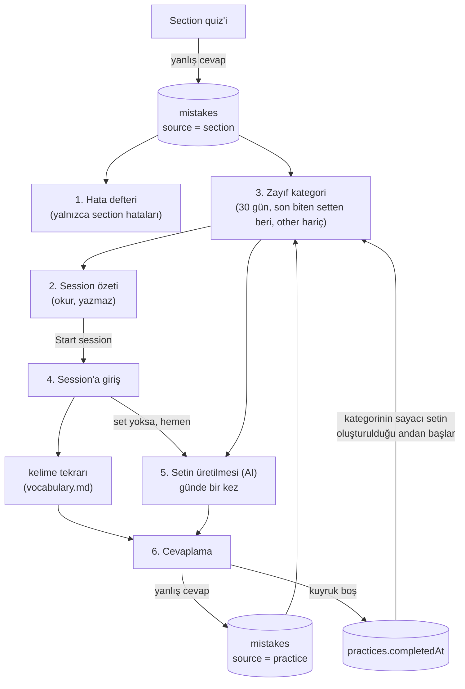
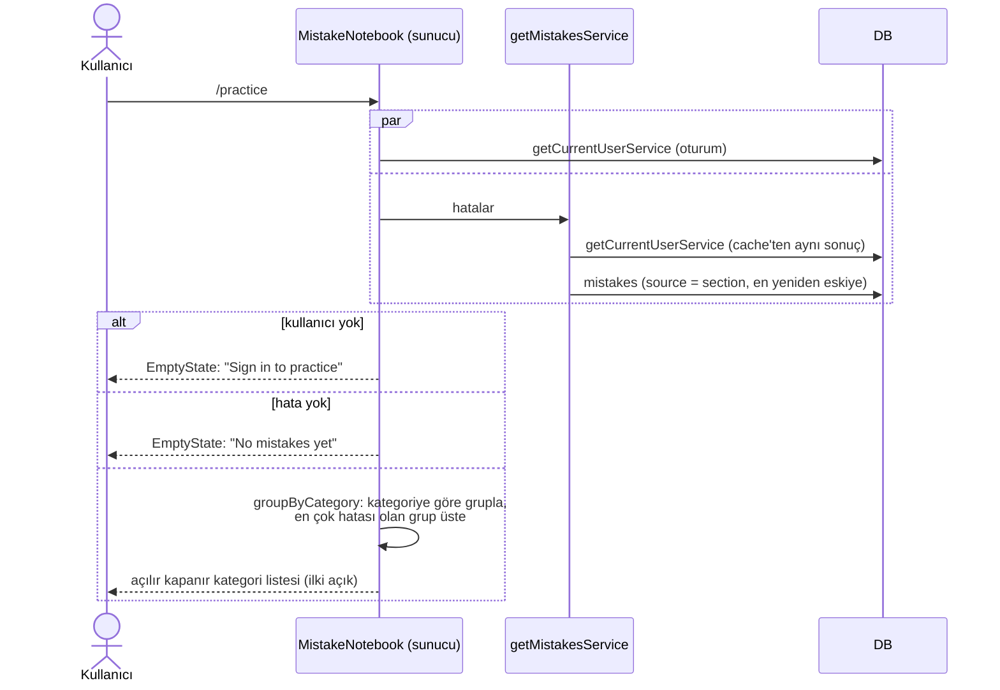
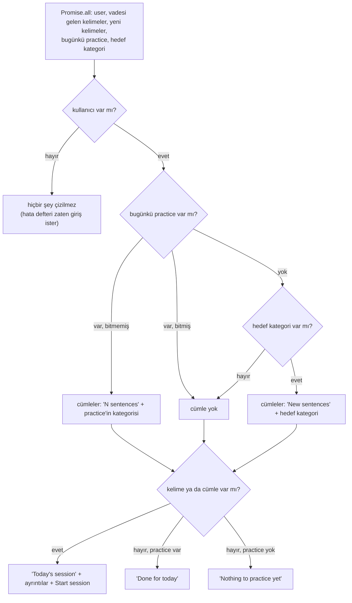
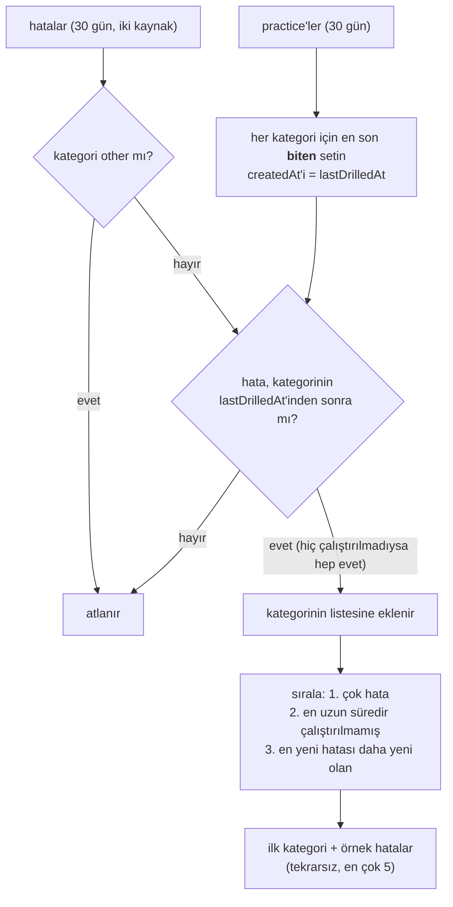
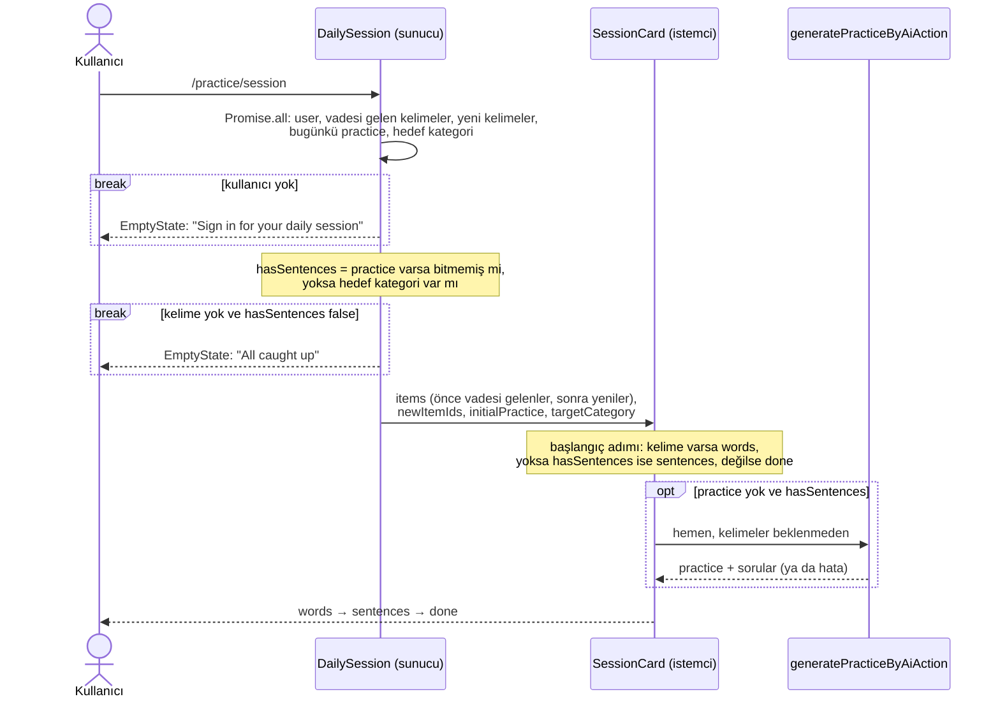
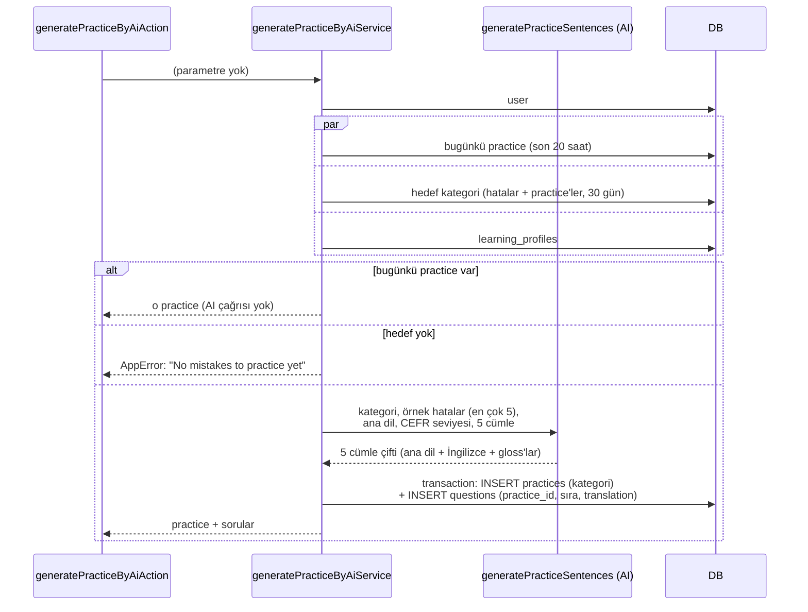
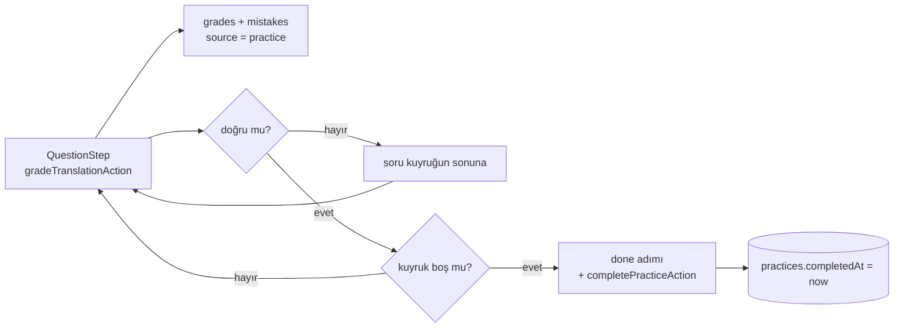

# Practice akışı

Quiz'lerde yapılan hataların geri dönüşü. Hatalar kategorilere ayrılıp hata defterinde listelenir.
Günlük session'da önce kelimeler tekrar edilir, sonra en zayıf kategori için AI'ın yazdığı 5
cümlelik bir set çevrilir. Set hatasız biterse kategori geri çekilir ve session başka bir
kategoriye geçer.

- **Giriş noktaları:**
  - Hata defteri ve özet: `app/(app)/practice/page.tsx`
  - Session: `app/(app)/practice/session/page.tsx`
- **Okuduğu tablolar:** `user`, `learning_profiles`, `mistakes`, `practices`, `questions`,
  `grades`, `vocabulary_items`, `vocabulary_cards`
- **Yazdığı tablolar:** `practices`, `questions`, `grades`, `mistakes` (kelime adımının yazdıkları
  için bkz. [vocabulary.md](./vocabulary.md))
- **AI görevleri:** `generatePracticeSentences` (set üretimi), `analyzeSentence` (değerlendirme)

## Genel bakış

Döngünün özü 3. bölümdeki kural: bir kategori, son biten setinden beri yapılan hatalar kadar
zayıftır. Bu yüzden:

- **Hatasız biten set** kategorinin sayacını sıfırlar, ertesi gün başka bir kategori çalışılır.
- **Hatalı biten set** hatalarını sayaca ekler, kategori zayıf kalmaya devam eder.
- **Yarım bırakılan set** hiçbir şeyi değiştirmez.

Hata defteri yalnızca section hatalarını gösterir. Zayıflık hesabı ise iki kaynağı da sayar.
"Bugün" henüz 20 saatlik bir pencereyle hesaplanır: bu pencerede oluşturulmuş bir set bugünün
setidir ve yenisi yazılmaz.

`/practice` sayfası iki bölümden oluşur, her biri kendi `Suspense` sınırında ayrı ayrı yüklenir:

- `SessionSummary` (`components/shared/session-summary.tsx`): günlük session'ın özeti ve başlatma
  düğmesi. Ortak bir bileşendir, `/progress` sayfası da kullanır.
- `MistakeNotebook` (`app/(app)/practice/_components/mistake-notebook.tsx`): hata defteri.

## 1. Hata defteri

Section quiz'lerinde yapılan hataların salt okunur listesi. Burada hiçbir şey yazılmaz ve
çalıştırılmaz. Hatalar daha sonra günlük session'da kategori bazında çalıştırılır.

- **Nerede:** `mistake-notebook.tsx` → `getMistakesService` (`services/mistake.ts`) →
  `getMistakes` (`dal/mistake/queries.ts`). Kartı `mistake-summary.tsx` çizer.
- **Okuduğu tablolar:** `user` (oturum), `mistakes`
- **Yazdığı tablolar:** yok
- **AI çağrısı:** yok
- **Dallanmalar:**
  - Kullanıcı yoksa giriş yapmaya çağıran bir `EmptyState` gösterilir. `(app)` layout'u
    misafirleri yönlendirmediği için sayfa onlara da açılır. Servis misafire boş liste döndüğünden
    kullanıcı kontrolü hata kontrolünden önce yapılmalıdır, yoksa misafir "No mistakes yet" görür.
  - Kullanıcının section hatası yoksa hata defterinin boş olduğunu söyleyen bir `EmptyState`
    gösterilir.
  - Kullanıcı ve hata varsa hatalar kategoriye göre gruplanır. Gruplar hata sayısına göre
    çoktan aza sıralanır, grubun içindeki hatalar en yeniden eskiye kalır. İlk grup (en çok
    hatası olan) açık gelir.
- **Gösterdiği:** her hata için tarih, yanlış kısım → düzeltmesi, açıklama, sorunun cümlesi ve
  kullanıcının cevabı.

---

**Notlar**

- Listede yalnızca `source = section` hataları var. Practice setlerinde yapılan hatalar da
  `mistakes` tablosuna yazılır ve kategorinin zayıflığına sayılır, ama burada gösterilmez: o
  kategori zaten günlük session'da tekrar çalıştırılıyor.
- Liste bütün zamanların hatalarını gösterir, sınır ya da sayfalama yoktur. Zayıf kategori
  seçiminde ise yalnızca yakın tarihli hatalar sayılır (bkz. ileriki bölümler).
- `other` kategorisi de listelenir, ama hiçbir zaman çalıştırılmaz.
- Cümle ve cevap hata satırına kopyalanmıştır. Soru silinse bile (`question_id` null olur) hata
  defterde eksiksiz görünmeye devam eder.
- Kullanıcı iki kez okunuyor gibi görünür (bileşende ve serviste), ama `getCurrentUserService`
  React `cache` ile sarıldığı için istek başına oturum bir kez okunur.

## 2. Session özeti

Bugünkü session'da ne olduğunu söyleyen kart ve session'ı başlatan düğme. Session sayfasının
kullandığı okumaların aynısını yapar, ama **hiçbir şey yazmaz**: practice seti burada oluşturulmaz,
yalnızca "oluşturulursa hangi kategoriyi çalıştıracağı" gösterilir.

- **Nerede:** `components/shared/session-summary.tsx` (`/practice` ve `/progress` sayfalarında)
- **Okuduğu servisler:**
  - `getCurrentUserService`: oturum
  - `getDueVocabularyItemsService`: vadesi gelmiş kelimeler (en çok 50)
  - `getNewVocabularyItemsService`: kartı olmayan, yani hiç tekrar edilmemiş kelimeler (en çok 10).
    İkisi için bkz. [vocabulary.md, Kelimelerin seçilmesi](./vocabulary.md#kelimelerin-seçilmesi).
  - `getPracticeService`: bugünkü set. Son 20 saatte oluşturulmuş practice'lerin **en yenisi**,
    soruları sırasıyla birlikte. Yoksa `null`.
  - `getPracticeTargetService`: yeni bir set yazılsaydı hangi kategoriyi çalıştıracağı (bkz.
    [3. Zayıf kategorinin seçilmesi](#3-zayıf-kategorinin-seçilmesi)).
- **Okuduğu tablolar:** `user`, `vocabulary_items`, `vocabulary_cards`, `practices`, `questions`,
  `mistakes`
- **Yazdığı tablolar:** yok
- **AI çağrısı:** yok
- **Dallanmalar:**
  - Kullanıcı yoksa bileşen `null` döner. Misafire giriş çağrısını aynı sayfadaki hata defteri
    zaten yapıyor.
  - Kelime sayısı vadesi gelenlerle yenilerin toplamıdır.
  - Cümle kısmı bugünkü practice'e göre belirlenir:
    - Practice varsa ve bitmemişse sorularının sayısı ve kategorisi gösterilir.
    - Practice varsa ve bitmişse cümle yoktur. Bugün yeni set yazılmaz.
    - Practice yoksa ve hedef kategori varsa "New sentences" ve o kategori gösterilir. Set henüz
      yok, session'a girilince oluşturulacak.
    - Practice yoksa ve hedef de yoksa (hiç çalıştırılabilir hata yoksa) cümle yoktur.
  - Kelime ya da cümle varsa başlık "Today's session" olur, ayrıntılar (`3 words · 5 sentences ·
Tense`) ve **Start session** düğmesi (`/practice/session`) görünür. İkisi de yoksa düğme
    çıkmaz. Başlık, bugün bir set yapıldıysa "Done for today", yapılmadıysa "Nothing to practice
    yet" olur.

## 3. Zayıf kategorinin seçilmesi

`getPracticeTargetService` (`services/practice.ts`) yeni bir setin hangi kategoriyi
çalıştıracağını ve AI'a örnek olarak hangi hataların verileceğini hesaplar. Bir tablo sorgusu
değildir, iki okumadan türetilir:

- `getRecentMistakesService`: son 30 gündeki hatalar, **her iki kaynaktan da** (`section` ve
  `practice`), en yeniden eskiye. Hata defterinin aksine practice hataları da sayılır: setteki
  bir hatanın tekrarlanması, kategorinin hâlâ zayıf olduğunu gösterir.
- `getPracticesService`: son 30 gündeki practice'ler (kategori, `completedAt`, `createdAt`), en
  yeniden eskiye. Daha eski bir setin etkisi olamaz, çünkü öncesindeki hatalar zaten pencerenin
  dışındadır.

1. **Son çalıştırılma zamanı:** her kategori için en son **biten** setin oluşturulma zamanı
   alınır. Bitmemiş setler atlanır. Yarım bırakılan bir set hiçbir şeyi değiştirmez, hataları geri
   gelir.
2. **Hataların sayılması:** `other` hiç sayılmaz, çünkü çalıştırılabilecek bir dilbilgisi konusu
   değil. Diğer hatalar, kategorilerinin son çalıştırılma zamanından **sonra** yapılmışsa sayılır.
   Hiç çalıştırılmamış bir kategoride 30 gündeki bütün hatalar sayılır.
3. **Sıralama:**
   1. Sayılan hatası çok olan kategori önce gelir.
   2. Eşitse en uzun süredir çalıştırılmamış olan önce gelir. Hiç çalıştırılmamış kategori en
      öndedir.
   3. O da eşitse en yeni hatası daha yeni olan önce gelir.
4. **Sonuç:** ilk kategori ve onun örnek hataları döner. Örnekler hataların en yenileridir;
   aynı `incorrect` + `correction` çifti (büyük/küçük harfe bakmadan) bir kez alınır, en çok 5
   tane. Sayılan hiç hata yoksa `null` döner.

---

**Notlar**

- Set biterse kategorisinin son çalıştırılma zamanı setin **oluşturulduğu** an olur, bittiği an
  değil. Böylece setin içinde yapılan hatalar da sayılmaya devam eder. Hatasız biten bir setten
  sonra kategorinin sayacı sıfırlanır ve session başka bir kategoriye geçer.
- Örnek hatalarda tekrar elemesi gerekiyor, çünkü yanlış cevaplanan soru yeniden sorulduğunda her
  deneme hatalarını yeniden yazar. Eleme olmasa örnekler aynı hatanın kopyalarıyla dolabilirdi.
- "Bugün" henüz `user.timeZone` ile değil, 20 saatlik bir pencereyle hesaplanıyor. Böylece her gün
  biraz farklı saatte gelen kullanıcı da günde bir set alır.

## 4. Session'a giriş

- **Nerede:** `app/(app)/practice/session/page.tsx` → `_components/daily-session.tsx` →
  `_components/session-card.tsx`
- **Okuduğu servisler:** session özetininkilerin aynısı (bkz. [2. Session özeti](#2-session-özeti)).
  Ayrı bir istek olduğu için veritabanından yeniden okunur.
- **Yazdığı tablolar:** girişte yok. Set `generatePracticeByAiAction` ile yazılır (bkz.
  [5. Setin üretilmesi](#5-setin-üretilmesi)).
- **Dallanmalar:**
  - Kullanıcı yoksa giriş yapmaya çağıran bir `EmptyState` gösterilir.
  - Yapılacak bir şey yoksa "All caught up" `EmptyState`'i gösterilir. Bunun için vadesi gelen ve
    yeni kelime olmamalı, cümle de olmamalı. Cümle olmaması iki durumda olur: bugünkü set
    bitmiştir, ya da set yoktur ve çalıştırılabilir hata kalmamıştır (hedef `null`).
  - Aksi halde `SessionCard`'a kelimeler tek bir dizi olarak verilir, önce vadesi gelenler sonra
    yeniler. Practice bu diziye girmez, ayrı prop olarak gider: bugünkü set (`initialPractice`) ve
    henüz yoksa yazılacağı kategori (`targetCategory`).
- **Adımlar (`phase`):**
  - `words`: kelime tekrarı (bkz. [vocabulary.md, Kelime tekrarı](./vocabulary.md#3-kelime-tekrarı-günlük-session)).
    Bitince cümle varsa `sentences`, yoksa `done`.
  - `sentences`: set hazır değilse `GeneratingStep`, üretim hata verdiyse "Sentences could not be
    prepared" `EmptyState`'i, hazırsa sorular gösterilir.
  - `done`: kelime ve cümle sayısıyla "Done for today" ekranı.
- **Setin istenmesi:** bugünkü set yoksa ve cümle olacaksa (hedef kategori varsa) `SessionCard`
  açılır açılmaz `generatePracticeByAiAction` çağrılır. Kelimeler bitene kadar beklenmez, böylece
  kullanıcı kelimeleri tekrar ederken set arka planda yazılır. `hasRequestedRef` aynı isteğin iki
  kez gitmesini engeller.

## 5. Setin üretilmesi

- **Nerede:** `generatePracticeByAiAction` (`actions/practice.ts`) →
  `generatePracticeByAiService` (`services/practice.ts`) → `generatePracticeSentences`
  (`ai/tasks/generate-practice-sentences.ts`)
- **Okuduğu tablolar:** `user`, `learning_profiles`, `practices`, `questions`, `mistakes`
- **Yazdığı tablolar:** `practices`, `questions`
- **AI çağrısı:** var, `generatePracticeSentences`. Quiz'in `generateSentences` görevinden
  ayrıdır: quiz cümleleri transcript'ten çıkarılır, practice cümleleri hatalardan yeni yazılır.
  Cümle çifti şeması ve gloss kuralları ortaktır. Prompt'un öne çıkan kuralları:
  - Her cümleyi çevirmek, kullanıcının yanlış yaptığı yapıyı **zorunlu** kılmalı.
  - Konu ve kelimeler yeni olmalı, kullanıcının cümleleri tekrar edilmemeli.
  - Kısa (5-12 kelime) ve günlük olmalı, seviye biliniyorsa o seviyede.
  - Çalıştırılan yapıyı taşıyan kelimelere gloss verilmemeli, kullanıcı onu kendisi üretmeli.
- **Dallanmalar:**
  - Kullanıcı yoksa hata döner (`Unauthorized`).
  - Bugünkü set zaten varsa AI çağrılmadan o döner. Sayfa yenilense ya da istek tekrarlansa bile
    günde bir kez maliyet oluşur.
  - Hedef kategori yoksa hata döner ("No mistakes to practice yet").
  - Öğrenme profili yoksa seviye `null` gider, prompt seviye notunu atlar. Profil zorunlu değildir.
- **Döndürdüğü:** `PracticeWithQuestions` (id, kategori, `completedAt: null`, sorular).

## 6. Cevaplama ve tamamlanma

Sorular quiz'deki bileşenlerle (`QuestionStep`) ve aynı not verme yoluyla
(`gradeTranslationAction` → `gradeTranslationService`) cevaplanır. Bkz.
[quiz-answer.md, Cevap değerlendirme](./quiz-answer.md#3-cevap-değerlendirme). Burada yalnızca
farklar yazılıdır.

- **Kaynak:** sorunun `practice_id`'si dolu olduğu için `grades` ve `mistakes` satırları
  `source = practice` ile yazılır. Bu hatalar hata defterinde görünmez, ama zayıf kategori
  hesabına girer.
- **Kuyruk:** yanlış cevaplanan soru kuyruğun sonuna gider. Her ilerlemede artan `attempt`
  sayacı, yeniden sorulan soruyu boş bir cevap kutusuyla yeniden çizer. Cevaplar saklanmadığı
  için sayfa yenilenirse set baştan başlar, ama yeniden üretilmez (bugünkü set döner).
- **Tamamlanma:** kuyruk boşalınca `done` adımına geçilir ve `completePracticeAction` çağrılır,
  cevabı beklenmez. `completePracticeService` bugünkü seti bulur ve `completedAt`'i yazar. Hata
  dönerse `done` ekranında gösterilir. Quiz'deki gibi istemciye güvenilir, sunucu cevapları
  yeniden sayamaz.
- **Tamamlanmanın etkisi:**
  - Session özeti "Done for today" der ve bugün yeni set yazılmaz.
  - Kategorinin son çalıştırılma zamanı setin oluşturulduğu an olur (bkz.
    [3. Zayıf kategorinin seçilmesi](#3-zayıf-kategorinin-seçilmesi)).
- **Gloss kaydı:** practice sorusundaki gloss'lar `savePracticeGlossAction` ile kaydedilir (bkz.
  [vocabulary.md](./vocabulary.md)).

---

**Notlar**

- Set üretimi hata verirse `hasRequestedRef` sıfırlanır, ama effect'in bağımlılıkları
  (`practice`, `hasSentences`) değişmediği için kendiliğinden yeniden denenmez. Yeniden denemek
  için sayfanın yenilenmesi gerekir.
- İki istek "bugünkü set var mı?" kontrolünü aynı anda geçerse iki set oluşabilir.
  `getPracticeService` en yenisini döndürdüğü için bu zararsızdır.
- **Gözlem:** `gradeTranslationService` soruyu yalnızca id ile bulur. Sorunun kullanıcının bugünkü
  setine (ya da gördüğü quiz'e) ait olup olmadığını kontrol etmez.
