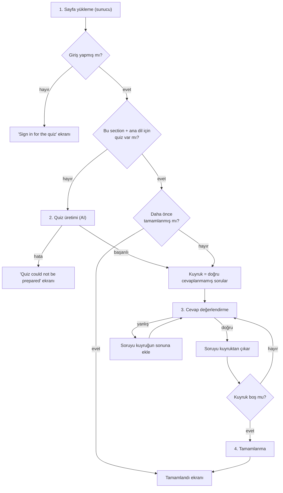
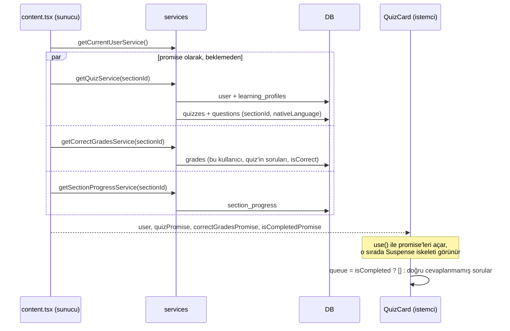
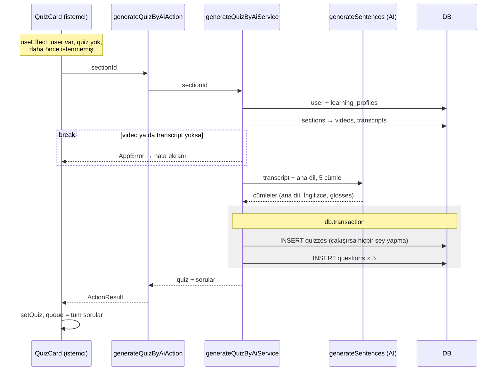
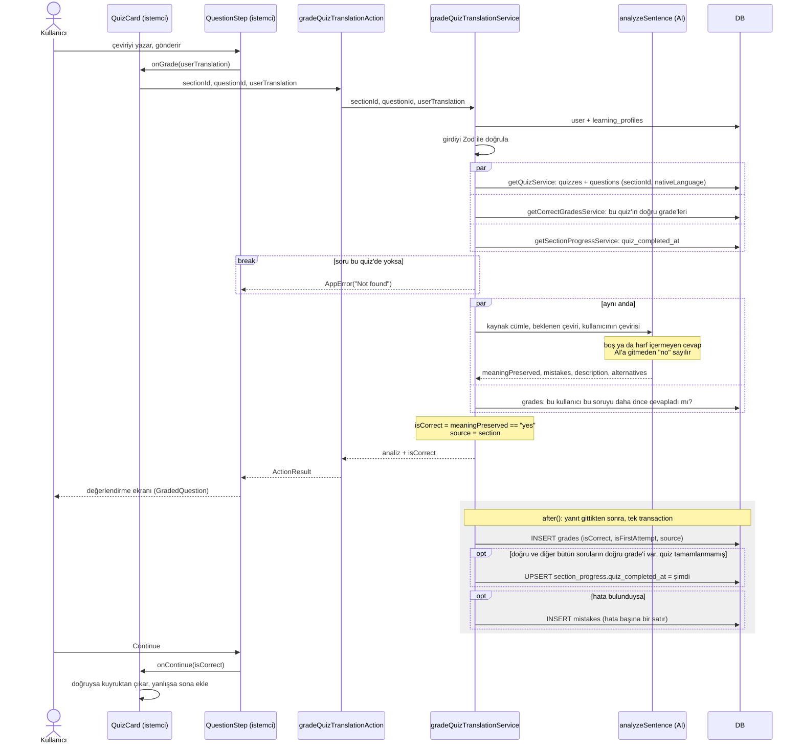
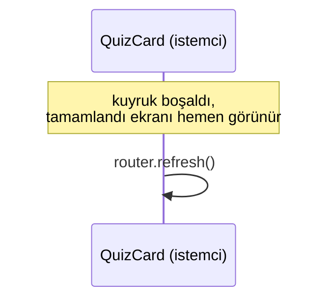

# Quiz akışı

Section sayfasındaki çeviri quiz'i. Kullanıcı ana dilindeki cümleyi İngilizceye çevirir, AI
değerlendirir. Yanlış cevaplanan soru kuyruğun sonuna döner, her soru doğru cevaplanınca quiz
tamamlanır. Quiz kaldığı yerden devam eder: yalnızca henüz doğru cevaplanmamış sorular sorulur.
Tamamlanmaya sunucu karar verir, restart yoktur.

- **Giriş noktası:** `app/(app)/programs/[programSlug]/[sectionSlug]/content.tsx`
- **Okuduğu tablolar:** `quizzes`, `questions`, `section_progress`, `sections`, `videos`,
  `transcripts`, `grades`, `learning_profiles`
- **Yazdığı tablolar:** `quizzes`, `questions`, `grades`, `mistakes`, `section_progress`
- **AI görevleri:** `generateSentences` (quiz üretimi), `analyzeSentence` (değerlendirme)

## Genel bakış

Tamamlanma sunucuda, 3. adımda yazılır: son soruyu doğru cevaplayan cevabın grade'iyle aynı
transaction'da. 4. adım yalnızca istemcinin tamamlandı ekranına geçmesidir.

## 1. Sayfa yükleme

- **Nerede:** `content.tsx` → `getQuizService`, `getCorrectGradesService` (`services/quiz.ts`),
  `getSectionProgressService` (`services/program.ts`), sunucuda. Promise'ler istemcideki
  `QuizCard`'a (`quiz-card.tsx`) verilir. Kuyruğu `getRemainingQuestionIds` kurar.
- **Okuduğu:** `learning_profiles`, `quizzes`, `questions`, `grades`, `section_progress`
- **Yazdığı:** yok
- **AI çağrısı:** yok
- **Dallanmalar:**
  - Kullanıcı ya da profili yoksa `getQuizService` null döner. Quiz ana dile göre tutulduğu için
    profili olmayan kullanıcıya quiz verilemez.
  - Kullanıcı yoksa `QuizCard` "Sign in" ekranını gösterir.
  - `quizCompletedAt` doluysa kuyruk boş başlar ve doğrudan tamamlandı ekranı görünür. Bu karar
    grade'lerden değil `quizCompletedAt`'ten gelir, çünkü grade'ler eklenmeden önce quiz'i
    bitirenlerin grade'i yoktur.
  - Tamamlanmamışsa kuyruk, bu kullanıcının doğru grade'i olmayan sorulardan (sırasıyla) oluşur.
    Bütün soruların doğru grade'i varken quiz tamamlanmamışsa (iki sekme son iki soruyu aynı anda
    cevapladıysa ya da eski akışta doğru cevaplar birden fazla ziyarete dağıldıysa) bütün sorular
    yeniden sorulur, ilk doğru cevap quiz'i tamamlar.
- **Döndürdüğü:** soruları sırasıyla (`order`) birlikte quiz, doğru grade'ler (`id`, `questionId`)
  ve tamamlanma bilgisi (boolean)

## 2. Quiz üretimi (quiz yoksa)

- **Nerede:** `quiz-card.tsx` (useEffect) → `actions/quiz.ts` → `generateQuizByAiService`
  (`services/quiz.ts`) → `ai/tasks/generate-sentences.ts`
- **Okuduğu:** `learning_profiles`, `sections`, `videos`, `transcripts`
- **Yazdığı:** `quizzes`, `questions` (tek transaction)
- **AI çağrısı:** var, `generateSentences`. Her soru `payload` içinde ana dil cümlesini
  (`sourceSentence`), beklenen İngilizce çeviriyi (`expectedTranslation`) ve `glosses`'u taşır.
  Her gloss dört alan taşır:
  - `nativeInContext`: kaynak cümleden harfi harfine ("vazgeçtim")
  - `nativeLemma`: ana dildeki sözlük biçimi ("vazgeçmek")
  - `englishLemma`: İngilizce sözlük biçimi ("give up")
  - `englishInContext`: beklenen çeviriden harfi harfine ("gave up")
- **Dallanmalar:**
  - Video ya da transcript yoksa `AppError` fırlatılır ve hata ekranı gösterilir.
  - Sorular yazılmadan önce `keepLocatableGlosses` (`lib/utils.ts`) her gloss'u cümlelerinde arar.
    `nativeInContext` kaynak cümlede, `englishInContext` (ya da cümle onu kullanıyorsa
    `englishLemma`) beklenen çeviride geçmiyorsa gloss atılır. Practice setleri de aynı kontrolden
    geçer.
  - Action başarısız olursa `hasRequestedRef` sıfırlanır, böylece sonraki render'da tekrar
    denenebilir.
- **Döndürdüğü:** `QuizWithQuestions`
- **Not:** Quiz kullanıcıya değil **section + ana dile** ait. Aynı dili konuşan ilk kullanıcı quiz'i
  üretir, sonrakiler aynı quiz'i görür. Servisteki TODO'ya göre ileride quiz'ler istek anında değil
  önceden üretilecek.

## 3. Cevap değerlendirme

- **Nerede:** `components/shared/quiz/question-step.tsx` (`handleSubmit`) → `onGrade`
  (`quiz-card.tsx`) → `actions/quiz.ts` → `gradeQuizTranslationService` (`services/quiz.ts`) →
  `ai/tasks/analyze-sentence.ts`. Kuyruk `quiz-card.tsx` içindeki `handleContinue`'da güncellenir.
- **Okuduğu:** `learning_profiles`, `quizzes`, `questions`, `grades`, `section_progress`
- **Yazdığı:** `grades` (her cevapta bir satır), `mistakes` (hata varsa, hata başına bir satır),
  `section_progress` (quiz'i tamamlayan cevapta)
- **AI çağrısı:** var, `analyzeSentence`
- **Dallanmalar:**
  - Soru id ile tek başına aranmaz, kullanıcının gördüğü quiz'in (`getQuizService`: section +
    kullanıcının ana dili) içinde aranır. Orada yoksa (başka dildeki quiz'in ya da bir practice'in
    sorusu) `AppError("Not found")` döner ve AI çağrılmaz.
  - `isCorrect` kararını sunucudaki kod verir, AI değil. AI'ın döndürdüğü `meaningPreserved`
    değeri `"yes"` ise doğru sayılır. Gramer hataları cevabı yanlış yapmaz, yalnızca gösterilir ve
    kaydedilir. `"partial"` ise yanlış sayılır.
  - `meaningPreserved` `"no"` ise kod `mistakes` listesini boşaltır, böylece anlamsız bir cevap
    hata geçmişini doldurmaz.
  - `isFirstAttempt`, bu kullanıcı için bu soruya ait **herhangi** bir grade yoksa true olur. Bu
    sorgu AI ile paralel çalıştığı için ek süre eklemez.
  - **Tamamlanma:** cevap doğruysa, quiz'in diğer bütün sorularının bu kullanıcıdan doğru grade'i
    varsa ve `quizCompletedAt` boşsa, `quiz_completed_at` grade ile aynı transaction'da yazılır
    (`gradeTranslation`'ın `onCorrect`'i). İkisi ya birlikte yazılır ya hiç yazılmaz.
    `quizCompletedAt` ilk tamamlanma anıdır ve bir daha değişmez. Tamamlanma için istemciden gelen
    bir istek yoktur, istemci kuyruğun boşaldığını sunucuya bildirmez.
  - `source` her zaman `section`'dır. Practice soruları aynı puanlama kodundan
    (`gradeTranslation`) geçer ama kendi giriş noktalarından gelir
    (`gradePracticeTranslationService`, `source = practice`).
- **Döndürdüğü:** `TranslationGrade` (kullanıcının çevirisi, analiz, `isCorrect`)
- **Gloss'lar:** cevap yazılırken kaynak cümledeki gloss'lu kelimelerin altı çizilidir ve popover
  yalnızca `englishLemma`'yı gösterir. Kelimenin cümlede nasıl çekileceği kullanıcıya bırakılır,
  çünkü gramer hataları `mistakes`'e yazılır. Değerlendirme ekranında beklenen çeviride de
  `englishInContext`'lerin altı çizilir ve popover "give up · vazgeçmek" gösterir. İki ekran da
  `GlossedText` (`components/shared/quiz/glossed-text.tsx`) bileşenini kullanır. Bir gloss
  öncekiyle çakışırsa altı çizilmez.
- **Yan çıkış:** sorudaki kelimeyi kaydetmek (`saveQuizGlossAction`) vocabulary akışına aittir.

## 4. Tamamlanma

- **Nerede:** `quiz-card.tsx` (`handleContinue`)
- **Okuduğu / Yazdığı:** yok. `quiz_completed_at` 3. adımda, son doğru cevabın grade'iyle yazıldı.
- **AI çağrısı:** yok
- **Not:** `router.refresh()` sunucu verisini (ve istemcinin router önbelleğini) yeniler. Son
  grade `after()` ile yazıldığı için refresh, yazma bitmeden gelirse sayfa bir an eski veriyi
  gösterebilir. Kullanıcı Continue'ya basana kadar yazma genellikle bitmiş olur.
- **Restart yok:** tamamlandı ekranında "Practice again" düğmesi yoktur. Aynı cümleleri yeniden
  çevirmek öğretici değil (beklenen çeviriler görüldü), hataları ise günlük practice tekrar eder.

## Kenar durumlar

- **Sayfa yenilenirse:** kuyruk tarayıcıda kaybolur ama sunucudan yeniden kurulur: doğru
  cevaplanmış sorular sorulmaz, yanlış cevaplanmış ve hiç cevaplanmamış sorular sırasıyla gelir.
  Yanıttan hemen sonra yenilenirse son grade henüz yazılmamış olabilir, o soru yeniden sorulur.
- **Tekrar denemeler:** yanlış cevaptan sonra verilen cevaplar `isFirstAttempt = false` ile
  kaydedilir. Doğruluk oranı yalnızca ilk denemeleri sayar. Bir sorunun birden fazla grade'i olabilir
  (yanlış, yanlış, doğru), ama doğru cevaplanan soru bir daha sorulmadığı için pratikte en fazla bir
  doğru grade'i olur.
- **Grade yazılamazsa:** `after()` içindeki transaction başarısız olursa grade de tamamlanma da
  yazılmaz. Soru sonraki ziyarette yeniden sorulur.

## Notlar

- **Cevap metni:** "Cevap metni saklanmaz" kuralı `grades` için geçerli. Hata varsa cevap
  `mistakes.user_translation` içine kopyalanır.
