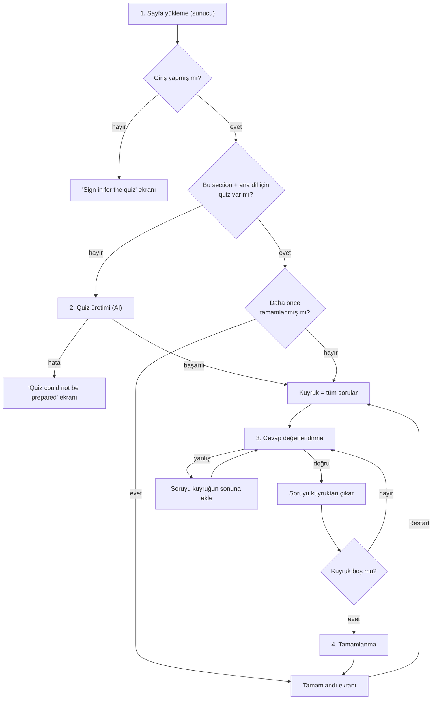
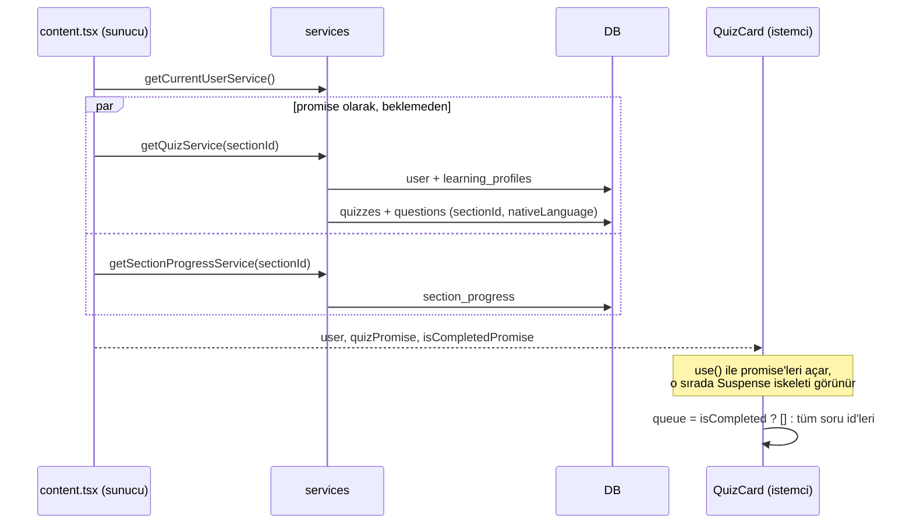
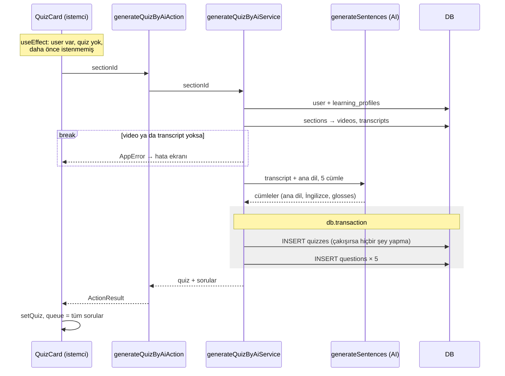
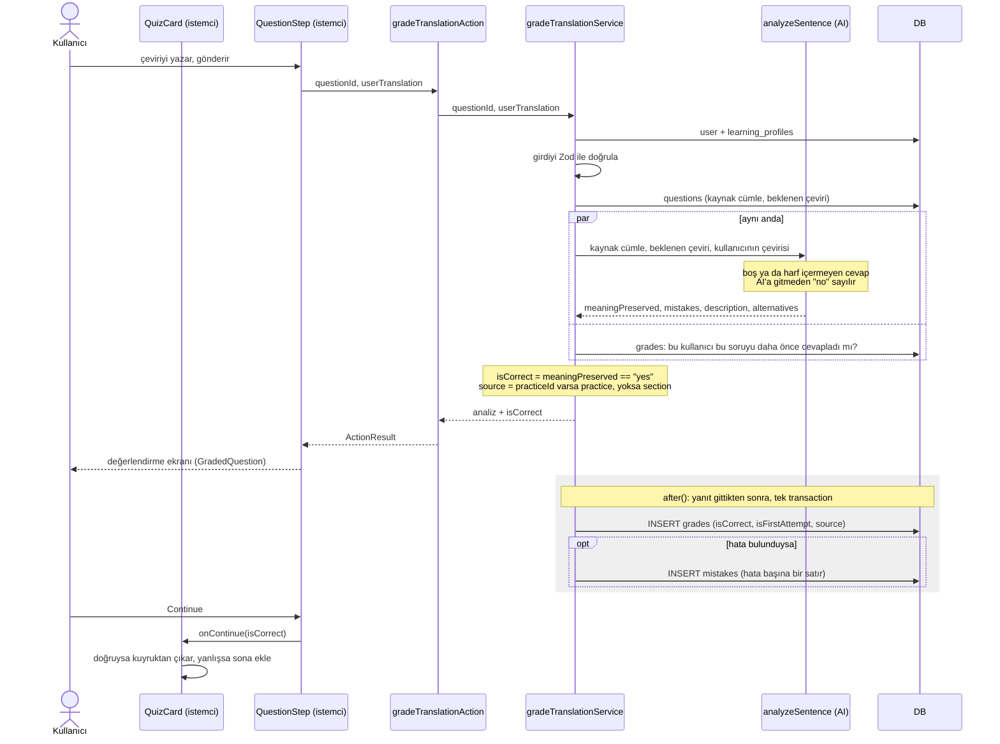
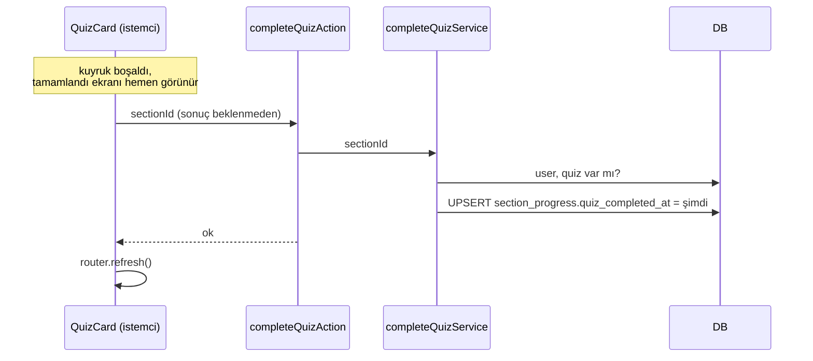

# Quiz akışı

Section sayfasındaki çeviri quiz'i. Kullanıcı ana dilindeki cümleyi İngilizceye çevirir, AI
değerlendirir. Yanlış cevaplanan soru kuyruğun sonuna döner, her soru doğru cevaplanınca quiz
tamamlanır.

- **Giriş noktası:** `app/(app)/programs/[programSlug]/[sectionSlug]/content.tsx`
- **Okuduğu tablolar:** `quizzes`, `questions`, `section_progress`, `sections`, `videos`,
  `transcripts`, `grades`, `learning_profiles`
- **Yazdığı tablolar:** `quizzes`, `questions`, `grades`, `mistakes`, `section_progress`
- **AI görevleri:** `generateSentences` (quiz üretimi), `analyzeSentence` (değerlendirme)

## Genel bakış

## 1. Sayfa yükleme

- **Nerede:** `content.tsx` → `getQuizService` (`services/quiz.ts`), `getSectionProgressService`
  (`services/program.ts`), sunucuda. Promise'ler istemcideki `QuizCard`'a (`quiz-card.tsx`) verilir.
- **Okuduğu:** `learning_profiles`, `quizzes`, `questions`, `section_progress`
- **Yazdığı:** yok
- **AI çağrısı:** yok
- **Dallanmalar:**
  - Kullanıcı ya da profili yoksa `getQuizService` null döner. Quiz ana dile göre tutulduğu için
    profili olmayan kullanıcıya quiz verilemez.
  - Kullanıcı yoksa `QuizCard` "Sign in" ekranını gösterir.
  - `quizCompletedAt` doluysa kuyruk boş başlar ve doğrudan tamamlandı ekranı görünür.
- **Döndürdüğü:** soruları sırasıyla (`order`) birlikte quiz, ve tamamlanma bilgisi (boolean)

## 2. Quiz üretimi (quiz yoksa)

- **Nerede:** `quiz-card.tsx` (useEffect) → `actions/quiz.ts` → `generateQuizByAiService`
  (`services/quiz.ts`) → `ai/tasks/generate-sentences.ts`
- **Okuduğu:** `learning_profiles`, `sections`, `videos`, `transcripts`
- **Yazdığı:** `quizzes`, `questions` (tek transaction)
- **AI çağrısı:** var, `generateSentences`. Her soru `payload` içinde ana dil cümlesini
  (`sourceSentence`), beklenen İngilizce çeviriyi (`expectedTranslation`) ve `glosses`'u taşır.
- **Dallanmalar:**
  - Video ya da transcript yoksa `AppError` fırlatılır ve hata ekranı gösterilir.
  - Action başarısız olursa `hasRequestedRef` sıfırlanır, böylece sonraki render'da tekrar
    denenebilir.
- **Döndürdüğü:** `QuizWithQuestions`
- **Not:** Quiz kullanıcıya değil **section + ana dile** ait. Aynı dili konuşan ilk kullanıcı quiz'i
  üretir, sonrakiler aynı quiz'i görür. Servisteki TODO'ya göre ileride quiz'ler istek anında değil
  önceden üretilecek.

## 3. Cevap değerlendirme

- **Nerede:** `components/shared/quiz/question-step.tsx` (`handleSubmit`) → `actions/quiz.ts` →
  `gradeTranslationService` (`services/quiz.ts`) → `ai/tasks/analyze-sentence.ts`. Kuyruk
  `quiz-card.tsx` içindeki `handleContinue`'da güncellenir.
- **Okuduğu:** `learning_profiles`, `questions`, `grades`
- **Yazdığı:** `grades` (her cevapta bir satır), `mistakes` (hata varsa, hata başına bir satır)
- **AI çağrısı:** var, `analyzeSentence`
- **Dallanmalar:**
  - `isCorrect` kararını sunucudaki kod verir, AI değil. AI'ın döndürdüğü `meaningPreserved`
    değeri `"yes"` ise doğru sayılır. Gramer hataları cevabı yanlış yapmaz, yalnızca gösterilir ve
    kaydedilir. `"partial"` ise yanlış sayılır.
  - `meaningPreserved` `"no"` ise kod `mistakes` listesini boşaltır, böylece anlamsız bir cevap
    hata geçmişini doldurmaz.
  - `isFirstAttempt`, bu kullanıcı için bu soruya ait **herhangi** bir grade yoksa true olur. Bu
    sorgu AI ile paralel çalıştığı için ek süre eklemez.
  - `source`, sorunun sahibinden çıkarılır: `practiceId` doluysa `practice`, değilse `section`. Bu
    servis practice soruları için de aynı şekilde kullanılır.
- **Döndürdüğü:** `TranslationGrade` (kullanıcının çevirisi, analiz, `isCorrect`)
- **Yan çıkış:** sorudaki kelimeyi kaydetmek (`saveQuizGlossAction`) vocabulary akışına aittir.

## 4. Tamamlanma

- **Nerede:** `quiz-card.tsx` (`handleContinue`) → `actions/quiz.ts` → `completeQuizService`
  (`services/quiz.ts`)
- **Okuduğu:** `learning_profiles`, `quizzes`
- **Yazdığı:** `section_progress` (yoksa ekler, varsa `quiz_completed_at`'i günceller)
- **AI çağrısı:** yok
- **Dallanmalar:** kullanıcı ya da quiz yoksa `AppError`
- **Döndürdüğü:** yok. Başarılıysa sayfa sunucudan yeniden render edilir.

## Kenar durumlar

- **Sayfa yenilenirse:** kuyruk yalnızca tarayıcıda tutulduğu için kaybolur. Quiz tamamlanmadıysa
  baştan, tüm sorularla başlar. Önceki cevapların `grades` satırları kalır.
- **Restart:** tamamlandı ekranındaki Restart kuyruğu tüm sorularla yeniden doldurur. Tekrar
  bitince `completeQuizAction` yine çağrılır ve `quiz_completed_at` yeni tarihle güncellenir.
- **Tekrar denemeler:** yanlış cevaptan sonra, ya da restart sonrası verilen cevaplar
  `isFirstAttempt = false` ile kaydedilir. Doğruluk oranı yalnızca ilk denemeleri sayar.

## Gözlemler ve açık sorular

- **İstemciye güveniliyor:** `completeQuizService` kuyruğun gerçekten boşaldığını doğrulayamaz,
  çünkü grade'ler quiz turuna değil cevaba bağlı (servis üstündeki "Trusts the client" yorumu).
- **Kayıtlar arka planda:** `grades` ve `mistakes`, `after()` içinde yanıt gönderildikten sonra
  yazılır. Kullanıcı sonucu beklemez, ama bu yazma başarısız olursa kullanıcı bundan haberdar
  olmaz.
- **Eşzamanlı üretim:** Aynı section + dil için iki istek aynı anda quiz üretirse ikisi de AI'ı
  çağırır. `createQuiz` çakışmada satır döndürmez, bu yüzden ikinci istek "Quiz could not be
  created" hatası alır (yenileyince var olan quiz yüklenir).
- **Cevap metni:** "Cevap metni saklanmaz" kuralı `grades` için geçerli. Hata varsa cevap
  `mistakes.user_translation` içine kopyalanır.
