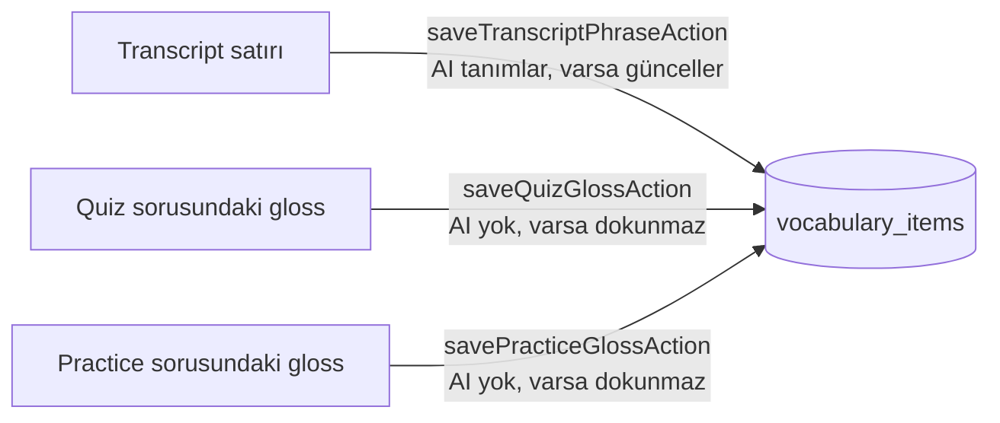
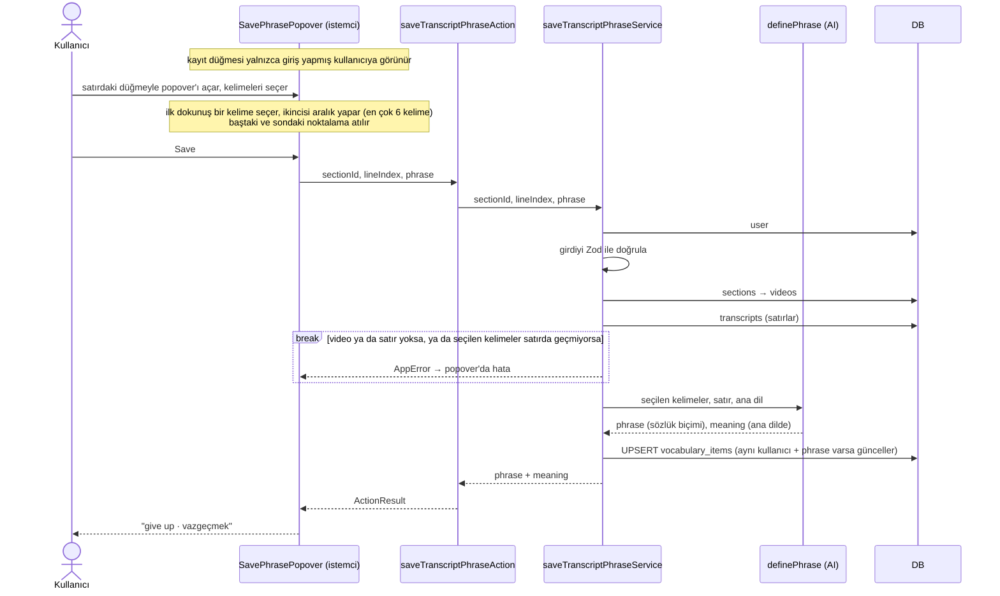
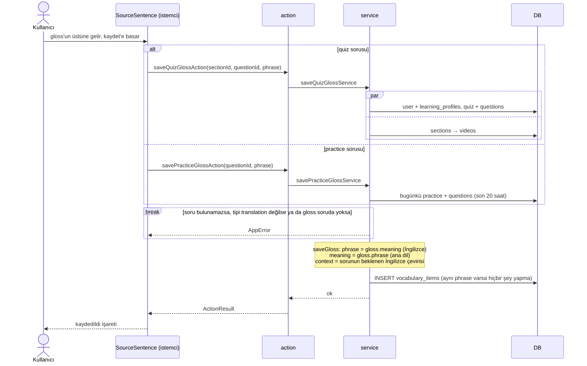
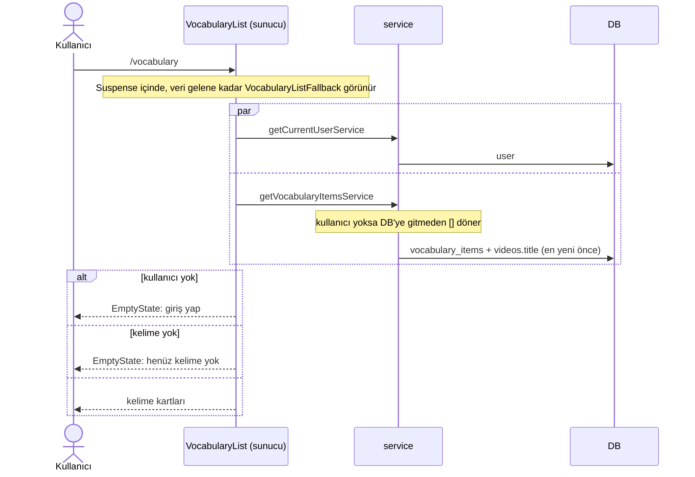
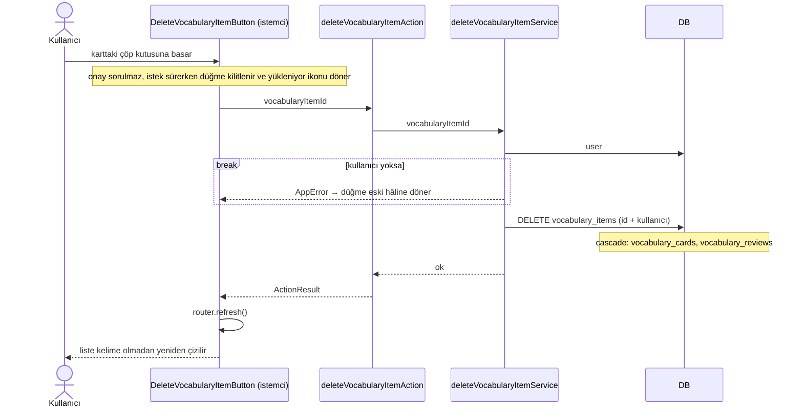
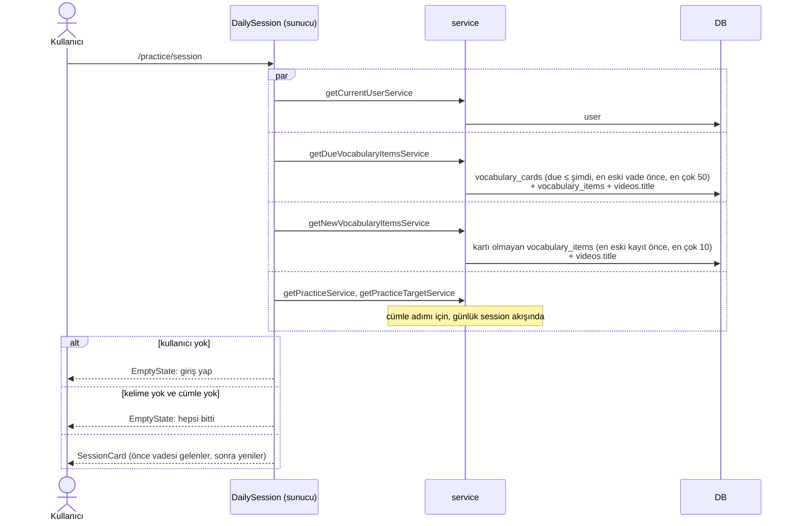
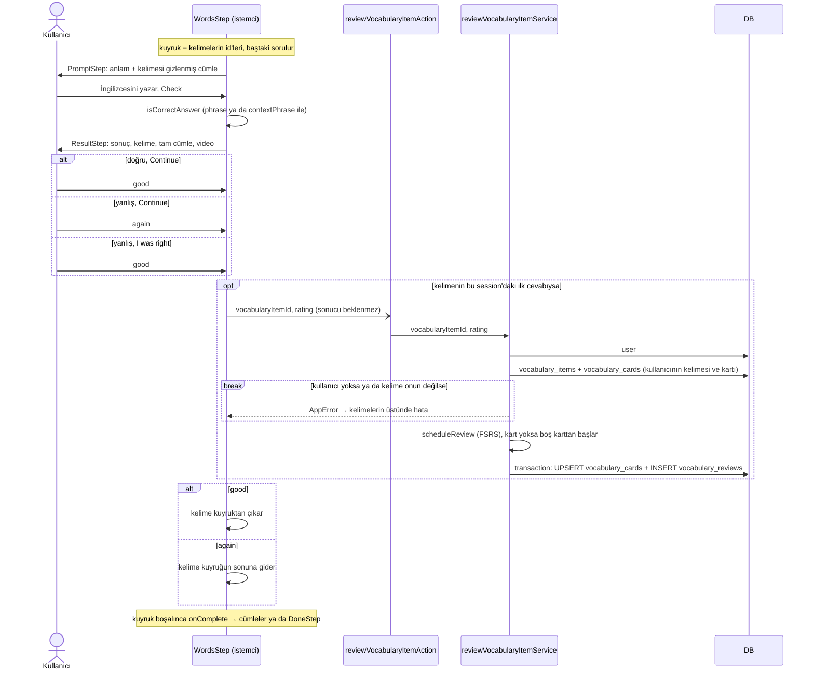

# Vocabulary akışı

- **Giriş noktaları:**
  - Transcript: `app/(app)/programs/[programSlug]/[sectionSlug]/_components/transcript-card/save-phrase-popover.tsx`
  - Quiz: `app/(app)/programs/[programSlug]/[sectionSlug]/_components/quiz-card.tsx`
  - Practice: `app/(app)/practice/session/_components/session-card.tsx`
  - Liste: `app/(app)/vocabulary/_components/vocabulary-list.tsx`
  - Tekrar: `app/(app)/practice/session/_components/words-step/index.tsx`
- **Okuduğu tablolar:** `user`, `learning_profiles`, `sections`, `videos`, `transcripts`, `quizzes`,
  `practices`, `questions`, `vocabulary_items`, `vocabulary_cards`
- **Yazdığı tablolar:** `vocabulary_items`, `vocabulary_cards`, `vocabulary_reviews` (silmede
  cascade ile kart ve tekrar geçmişi de silinir)
- **AI görevleri:** `definePhrase` (yalnızca transcript'ten kayıtta)

## 1. Kelime kaydetme

### Transcript'ten kelime kaydetme

- **Nerede:** `save-phrase-popover.tsx` (`handleSave`) → `saveTranscriptPhraseAction`
  (`actions/vocabulary.ts`) → `saveTranscriptPhraseService` (`services/vocabulary.ts`) →
  `definePhrase` (`ai/tasks/define-phrase.ts`)
- **Okuduğu tablolar:** `user`, `sections`, `videos`, `transcripts`
- **Yazdığı tablolar:** `vocabulary_items`
- **AI çağrısı:** var, `definePhrase`. Seçilen kelimeleri sözlük biçimine çevirir ("giving up" →
  "give up") ve o cümledeki anlamını ana dilde verir.
- **Dallanmalar:**
  - Kullanıcı yoksa (`Unauthorized`), section'ın videosu yoksa, `lineIndex`'te satır yoksa
    (`Not found`) ya da seçilen kelimeler satırda bütün kelimeler olarak geçmiyorsa hata döner.
    Son kontrol `matchPhrase` ile yapılır ve büyük/küçük harfe bakmaz.
  - Kelime zaten kayıtlıysa yeni satır açılmaz, var olan güncellenir: `meaning`, `context`,
    `contextPhrase`, `video_id` ve `time_seconds` yeni kayıttan gelir. Kelimenin tekrar takvimi
    (`vocabulary_cards`) ayrı tabloda durduğu için sıfırlanmaz.
- **Döndürdüğü:** `PhraseDefinition` (sözlük biçimi ve ana dildeki anlamı). Popover'da gösterilir.

### Quiz ya da practice sorusundan kelime kaydetme (gloss)

Gloss, AI'ın soru üretirken cümledeki kelimelere eklediği ipucudur. Soru cümlesinde altı çizili
kelimenin üstüne gelince anlamı ve kaydet düğmesi görünür. Quiz ve practice aynı bileşenleri ve
aynı kayıt fonksiyonunu (`saveGloss`) kullanır. Fark yalnızca sorunun nereden doğrulandığındadır.

- **Nerede:**
  - Quiz: `quiz-card.tsx` → `question-step.tsx` → `answer-input.tsx` / `graded-question.tsx` →
    `source-sentence.tsx` (`SaveGlossButton`) → `saveQuizGlossAction` (`actions/vocabulary.ts`) →
    `saveQuizGlossService` (`services/vocabulary.ts`)
  - Practice: `session-card.tsx` → aynı bileşenler → `savePracticeGlossAction` →
    `savePracticeGlossService`
  - İkisi de sonunda `saveGloss` fonksiyonunu çağırır.
  - Hangi action'ın çağrılacağına bileşenler değil, `onSaveGloss` prop'unu veren üst bileşen
    (`quiz-card.tsx` ya da `session-card.tsx`) karar verir.
- **Okuduğu tablolar:**
  - Quiz: `user`, `learning_profiles`, `quizzes`, `questions`, `sections`, `videos`
  - Practice: `user`, `practices`, `questions`
- **Yazdığı tablolar:** `vocabulary_items`
- **AI çağrısı:** yok. Gloss'un çevirisi soru üretilirken zaten hazırlanmış.
- **Dallanmalar:**
  - Kullanıcı yoksa hata döner (`Unauthorized`).
  - Soru, kullanıcının bu section için gördüğü quiz'de (quiz) ya da bugünkü practice setinde
    (practice) yoksa hata döner (`Not found`).
  - Soru tipi `translation` değilse hata döner. Şu an başka soru tipi yok.
  - İstenen gloss sorunun `glosses` listesinde yoksa hata döner (`Not found`).
  - Kelime zaten kayıtlıysa **hiçbir şey değişmez** ve yine başarılı döner. Var olan kaydın
    bağlamı bir videodan gelmiş olabilir, gloss onu ezmemeli.
- **Döndürdüğü:** veri yok. İstemci yalnızca başarılı olup olmadığını öğrenir.

### Kaynağa göre kaydın alanları

| Alan                 | Transcript                         | Quiz gloss                                          | Practice gloss            |
| -------------------- | ---------------------------------- | --------------------------------------------------- | ------------------------- |
| `phrase` (İngilizce) | AI'ın verdiği sözlük biçimi        | `gloss.meaning`                                     | `gloss.meaning`           |
| `meaning` (ana dil)  | AI'ın verdiği anlam                | `gloss.phrase`                                      | `gloss.phrase`            |
| `context`            | transcript satırı                  | sorunun beklenen çevirisi                           | sorunun beklenen çevirisi |
| `context_phrase`     | seçilen kelimeler (her zaman dolu) | sözlük biçimi cümlede aynen geçiyorsa o, yoksa null | aynı                      |
| `video_id`           | section'ın videosu                 | section'ın videosu (varsa)                          | null                      |
| `time_seconds`       | satırın zamanı                     | null                                                | null                      |
| Tekrar kaydedilirse  | günceller                          | değiştirmez                                         | değiştirmez               |

---

**Notlar**

- `context_phrase` transcript kaydında her zaman doludur, çünkü kullanıcı kelimeleri cümlenin
  içinden seçer ve cümlede geçtikleri zaten doğrulanmıştır. Gloss'ta da cümle elimizde, ama
  İngilizce kelime sözlük biçiminde gelir. Cümle "gave up" diyorsa "give up" orada bulunamaz ve
  `context_phrase` null kalır.
- `video_id` transcript'ten ve quiz'den kayıtta dolu (quiz section'ın videosunu kullanır),
  practice'ten kayıtta boştur. `time_seconds` yalnızca transcript'ten kayıtta doludur. Şemadaki
  `vocabulary_items_time_needs_video_check` kısıtı, video olmadan zaman kaydedilmesini engeller.
- **Gözlem:** transcript'ten kayıt yalnızca giriş yapmayı ister. Quiz gloss'u ise
  `getQuizService` üzerinden öğrenme profilini de ister.

## 2. Kelime listesi

### Görüntüleme

- **Nerede:** `page.tsx` → `vocabulary-list.tsx` (`VocabularyList`) → `getCurrentUserService`
  (`services/auth.ts`) ve `getVocabularyItemsService` (`services/vocabulary.ts`)
- **Okuduğu tablolar:** `user`, `vocabulary_items`, `videos`
- **Yazdığı tablolar:** yok
- **AI çağrısı:** yok
- **Dallanmalar:**
  - Kullanıcı yoksa giriş yapmaya çağıran `EmptyState` gösterilir.
  - Kullanıcının kayıtlı kelimesi yoksa kelimenin nereden kaydedileceğini anlatan `EmptyState`
    gösterilir.
- **Döndürdüğü:** `VocabularyItemListItem[]`, en yeni kayıt önce. Her kartta `phrase`, `meaning`,
  `context`, varsa videonun başlığı ve `time_seconds`, bir de kayıt tarihi görünür.
  `contextPhrase` de gelir ama bu sayfada kullanılmaz (tekrar kartında kelimeyi gizlemek içindir).

### Silme

- **Nerede:** `vocabulary-list.tsx` (her kartta) → `delete-vocabulary-item-button.tsx`
  (`handleDelete`) → `deleteVocabularyItemAction` (`actions/vocabulary.ts`) →
  `deleteVocabularyItemService` (`services/vocabulary.ts`)
- **Okuduğu tablolar:** `user`
- **Yazdığı tablolar:** `vocabulary_items` (DB cascade ile `vocabulary_cards` ve
  `vocabulary_reviews` da silinir)
- **AI çağrısı:** yok
- **Dallanmalar:**
  - Kullanıcı yoksa hata döner (`Unauthorized`). İstemci hatayı göstermez, düğme yalnızca eski
    hâline döner.
  - Silme yalnızca kullanıcının kendi kaydını hedefler. Kayıt yoksa ya da başkasınınsa hiçbir satır
    silinmez ama yine başarılı döner (`Not found` yok).
- **Döndürdüğü:** veri yok. Başarılıysa istemci `router.refresh()` ile sayfayı yeniden ister, liste
  sunucudan güncel hâliyle gelir.
- **Not:** kelime yeniden kaydedilirse kartı olmadığı için "yeni" olarak başlar.

## 3. Kelime tekrarı (günlük session)

Kaydedilen kelimeler `/practice/session`'ın ilk adımında tekrar edilir. Cevap istemcide kontrol
edilir, sunucuya yalnızca puan (`rating`) gider. Kelimeler bitince session cümlelere geçer (günlük
session akışı).

### Kelimelerin seçilmesi

- **Nerede:** `daily-session.tsx` → `getDueVocabularyItemsService` ve
  `getNewVocabularyItemsService` (`services/vocabulary.ts`) → `session-card.tsx`
- **Okuduğu tablolar:** `user`, `vocabulary_cards`, `vocabulary_items`, `videos`
- **Yazdığı tablolar:** yok
- **AI çağrısı:** yok
- **Dallanmalar:**
  - Kullanıcı yoksa giriş yapmaya çağıran `EmptyState` gösterilir.
  - Ne vadesi gelen ne yeni kelime varsa ve cümle adımı da yoksa "All caught up" gösterilir.
  - Kelime varsa session kelimelerle başlar, yoksa doğrudan cümlelere geçer.
- **Döndürdüğü:** `items` (önce vadesi gelenler, çünkü unutulmakta olanlar onlar) ve `newItemIds`
  (yalnızca "New word" rozeti için).

### Bir kelimenin tekrarı

- **Nerede:** `session-card.tsx` → `words-step/index.tsx` (`handleContinue`) → `prompt-step.tsx` /
  `result-step.tsx` (kontrol `words-step/utils.ts`) → `reviewVocabularyItemAction`
  (`actions/vocabulary.ts`) → `reviewVocabularyItemService` (`services/vocabulary.ts`) →
  `scheduleReview` (`lib/fsrs.ts`)
- **Okuduğu tablolar:** `user`, `vocabulary_items`, `vocabulary_cards`
- **Yazdığı tablolar:** `vocabulary_cards` (kelimenin ilk tekrarında oluşur, sonra güncellenir),
  `vocabulary_reviews` (her tekrarda bir satır: `rating` ve tekrardan önceki `state`, kart yoksa
  `new`; cevap metni saklanmaz)
- **AI çağrısı:** yok
- **Kartın ön yüzü:** anlam (`meaning`) ve cümle (`context`). Cümledeki `contextPhrase` kelime
  başına bir boşlukla gizlenir. `contextPhrase` null ise ya da cümlede bulunamazsa cümle cevabı
  ele vereceği için cevaptan sonraya bırakılır.
- **Kontrol:** büyük/küçük harf, noktalama ve kıvrık kesme işareti yok sayılır. Cevap `phrase`
  (sözlük biçimi) ya da `contextPhrase` (cümledeki biçim) ile aynıysa doğrudur: "give up" da
  "gave up" da kabul edilir.
- **Puan:**

  | Sonuç                   | `rating` | Kuyruk         |
  | ----------------------- | -------- | -------------- |
  | Doğru, Continue         | `good`   | çıkar          |
  | Yanlış, Continue        | `again`  | sona gider     |
  | Yanlış, "I was right"   | `good`   | çıkar          |

  "I was right", kontrolün ayırt edemediği eş anlamlı ya da yazım hatası içindir. `hard` ve `easy`
  hiç gönderilmez.

- **Dallanmalar:**
  - Kullanıcı yoksa (`Unauthorized`) ya da kelime yoksa veya başkasınınsa (`Not found`) hata
    döner. Hata kelimeler adımının üstünde ve `DoneStep`'te gösterilir, akış durmaz.
  - Yanlış cevaplanan kelime session'ın sonunda yeniden sorulur ama sunucuya yalnızca ilk cevap
    gider (`reviewedRef`). Tekrar sorma yalnızca alıştırmadır.
- **Döndürdüğü:** veri yok.

---

**Notlar**

- FSRS yalnızca uzun vadeli planlıyor (`enable_short_term: false`). Bu modda kart her puandan
  sonra `review` durumuna geçer: `learning` ve `relearning` hiç oluşmaz, `again` de kelimeyi en
  erken ertesi güne planlar.
